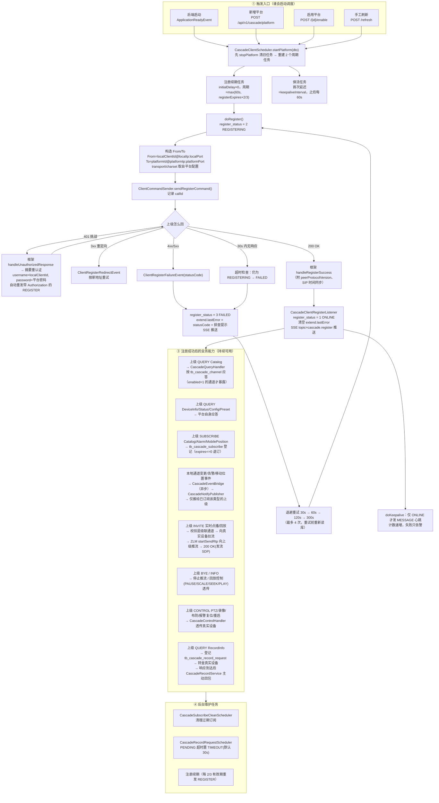
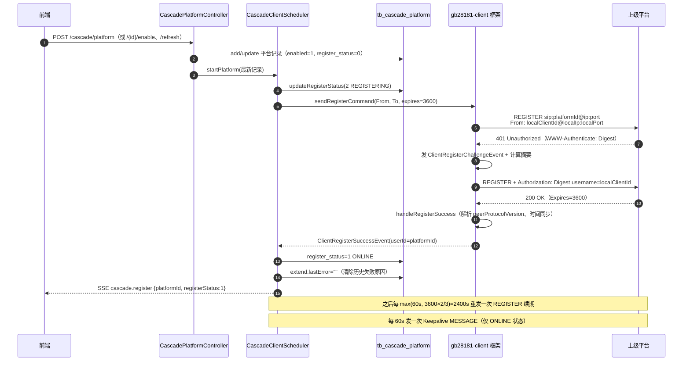
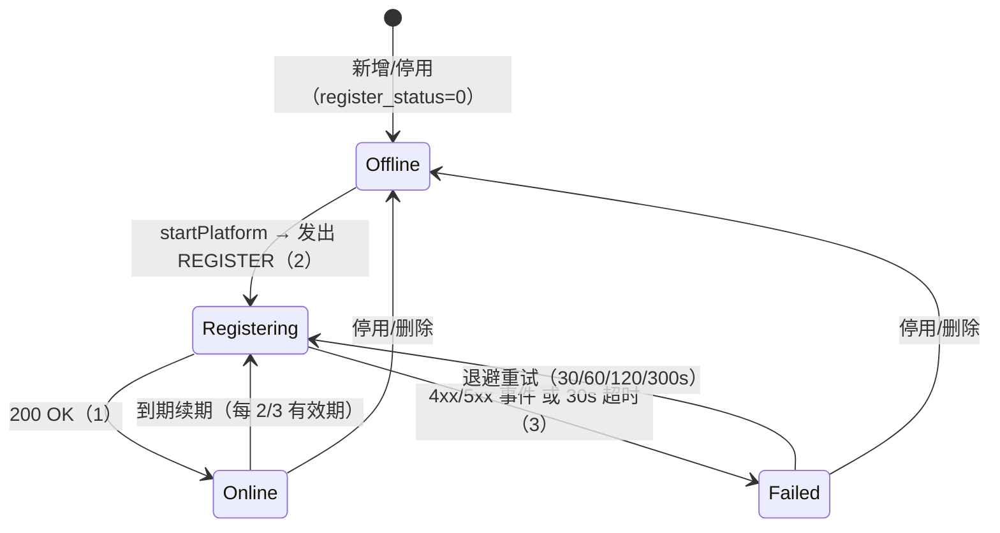

# 级联上级平台：完整链路流程图（1.0.11）

> 目的：从"点保存"到"上级能点播"，把注册、注册中、注册完成以及完成之后的每一步落到具体类与表，便于熟悉链路和排障。
>
> 相关文档：`doc/1.0.11/CASCADE-PLATFORM-SECURITY-HARDENING.md`（安全整改）、`doc/1.0.8/GB28181-CASCADE-CLIENT-TECH-PLAN.md`（协议方案）

---

## 1. 角色与地址约定

| 角色 | 国标 ID | SIP 地址 | 作用 |
| --- | --- | --- | --- |
| 上级平台（To） | `platformId` | `platformIp:platformPort` | 接收本端 REGISTER、下发 QUERY/SUBSCRIBE/INVITE/CONTROL |
| 本端客户端（From） | `localClientId` | `localIp:localPort`（默认 192.168.118.7:5061） | 发起注册、发心跳、应答查询、推流 |

- `From` 的 ID 同时是 SIP 摘要鉴权的 username，`password` 是口令。
- `Contact` 头由框架按 `localClientId@localIp:localPort` 生成，所以 `localIp/localPort` 必须是上级能回包的地址。
- 通道映射表 `tb_cascade_channel` 决定"上级看到的通道号 ↔ 本端真实设备通道"。

---

## 2. 全景流程图



---

## 3. 注册阶段时序图（含 401 挑战）



---

## 4. 阶段拆解

### A. 触发（谁把任务建起来）

| 入口 | 代码 | 说明 |
| --- | --- | --- |
| 服务启动 | `CascadeClientScheduler.onApplicationReady()` → `refreshRegistrations()` | 加载 `enabled=1` 的所有平台，对"任务表里不存在"的启动 |
| 新增平台 | `CascadePlatformController.add()` | 落库后按最新记录启动（`enabled=1` 才启动） |
| 启用平台 | `/{id}/enable` | 必要时用 `sip.client.domain/port` 回填本端地址，再启动 |
| 手工刷新 | `/refresh` | 兜底：补齐所有未调度的启用平台 |

> 没有定时扫描：**运行期新增必须靠 add 主动启动**，否则记录会一直 `register_status=0`（这就是"已启用却离线"的经典成因）。

### B. 注册（0 → 2 → 1 / 3）

1. `doRegister()` 先把状态置 `2 REGISTERING`，再发包（保证前端/运维能看到"注册中"）。
2. 框架 `RegisterRequestBuilder` 用 `FromDevice` 生成 From/Contact/Via；摘要 username 取 `localClientId`。
3. 上级回 401 → 框架 `handleUnauthorizedResponse` 走摘要重认证后自动重发（不是应用层重发）。
4. 200 OK → 框架发 `ClientRegisterSuccessEvent` → `CascadeClientRegisterListener` 置 `1 ONLINE`、清 `extend.lastError`、推 SSE。
5. 4xx/5xx → `ClientRegisterFailureEvent` → 置 `3 FAILED`、写 `extend.lastError`（含 401/403/404/408 排查提示）、安排退避重试。
6. 30s 内没有任何响应 → 超时检查把仍为 `REGISTERING` 的记录置 `FAILED`，原因"REGISTER 响应超时(30s)"，同样进入退避重试。

失败重试节奏：`30s → 60s → 120s → 300s`，第 5 次起回落到常规续期周期；每次重试前重新读库，平台已停用/删除则放弃。

### C. 注册完成之后（ONLINE 期间持续做的事）

| 方向 | 上级动作 | 本端处理 | 依赖数据 |
| --- | --- | --- | --- |
| 收 | QUERY Catalog | `CascadeQueryHandler.onCatalogQuery` 返回 `enabled=1` 的映射通道 | `tb_cascade_channel` |
| 收 | QUERY DeviceInfo / DeviceStatus / Config / Preset | 平台自身固定应答（配置 OK、预置位空列表） | — |
| 收 | SUBSCRIBE Catalog / Alarm / MobilePosition | `CascadeSubscribeHandler` 登记订阅意图，`expires<=0` 退订 | `tb_cascade_subscribe` |
| 发 | 本地通道增删改、告警、移动位置事件 | `CascadeEventBridge`（异步）→ `CascadeNotifyPublisher` 只推给已订阅该类型的在线上级 | 订阅表 + 通道映射 |
| 收 | INVITE 实时点播 / 回放 | `CascadeMediaInviteListener`：校验是级联通道 → 向真实设备 `inviteRealTimePlay/invitePlayBack` → `ZLM startSendRtp` 推流 → 200 OK | `tb_cascade_channel` + ZLM 节点 |
| 收 | BYE / INFO | 停推流；回放控制 PAUSE/SCALE/SEEK/PLAY 透传真实设备 | 活跃会话 |
| 收 | CONTROL PTZ / 录像 / 布防 / 报警复位 / 重启 | `CascadeControlHandler` 透传真实设备 | 通道映射 |
| 收 | QUERY RecordInfo | 登记 `tb_cascade_record_request` → 转查真实设备 → 响应到达后 `CascadeRecordService` 主动回包 | 请求表 |
| 发 | Keepalive MESSAGE（每 60s） | 仅 `ONLINE` 才发；离线不补发，等注册续期恢复 | — |

### D. 一直运行的维护任务

| 任务 | 周期 | 作用 |
| --- | --- | --- |
| 注册续期 | `max(60s, registerExpires×2/3)`（3600 → 40 分钟） | 保持注册有效，防止上级判离线 |
| 保活心跳 | `keepaliveInterval`（默认 60s） | 告知上级"我还活着" |
| 订阅清理 | `CascadeSubscribeCleanScheduler` | 过期订阅置失效，避免继续推送 |
| 录像请求超时 | `CascadeRecordRequestScheduler` | `PENDING` 超时置 `TIMEOUT`，避免请求表泄漏 |

---

## 5. 状态机与可观测字段



| 观测点 | 位置 | 期望 |
| --- | --- | --- |
| 注册状态 | `tb_cascade_platform.register_status` / 列表接口 `registerStatus` + `registerStatusName` | 0→2→1 |
| 失败原因 | `extend.lastError` / 接口 `lastError`、`lastErrorAt` | 401/403 时给出"核对 localClientId/密码" |
| 实时状态 | SSE `cascade.register`（仅推 ONLINE / FAILED） | 前端列表即时刷新 |
| 关键日志 | `级联调度已启动` / `发起级联注册` / `级联 REGISTER 已发送` / `级联注册成功` / `级联注册失败` / `级联保活失败` | 带 target 与 localClientId |
| 通道映射 | `tb_cascade_channel` | 上级 Catalog 能看到的通道数=该表 enabled=1 行数 |

> 注意：`REGISTERING` 只存在于"发包到响应"的几十毫秒到 30s 之间，且**不发 SSE**，列表需要手动刷新才可能看到 2。

---

## 6. 排障索引（现象 → 先看什么）

| 现象 | 首先确认 | 常见原因 |
| --- | --- | --- |
| 已启用但一直"离线"(0) | 记录 `create_time` 是否晚于进程启动 | 运行期新增未触发调度（历史 bug，已修）；或调度被 /disable、/refresh 前未启动 |
| 一直"注册中"(2) 30s 后转"失败" | `extend.lastError`、日志 `级联注册响应超时` | 报文没到上级：IP/端口错、传输协议(UDP/TCP)不一致、防火墙、本端 localIp 填了不可达地址 |
| "注册失败" statusCode=401/403 | `localClientId` 是否与上级登记的一致、密码 | 上级登记的下级编码与表单 `localClientId` 不一致（最常见）；密码错 |
| statusCode=404 | `platformId` / `platformDomain` | 上级不认识该平台 ID |
| 注册成功但上级看不到通道 | `tb_cascade_channel` 是否绑定且 enabled=1 | 没做通道映射；映射的 `cascadeChannelId` 与上级目录冲突 |
| 上级点播黑屏/超时 | 日志 `级联 INVITE` / `ZLM startSendRtp` | 真实设备拉流失败、ZLM 节点不可用、SSRC/端口冲突 |
| 保活失败告警 | 目标地址与网络 | 上级端口变化、UDP 丢包、注册已过期 |
| 海康侧端口该填哪个 | 海康“信令服务 → GB/T28181 服务 → 信令服务子节点” | 要填**SIP 通信端口**（如 7100），不是子节点端口（7099）、也不是客户端端口（7097） |
| 注册收到 `400 Bad Request` + `<ErrorCode>0x02201037</ErrorCode>` | 海康是否已添加“下级域”并登记本端编码/IP/端口 | 未登记的下级会被直接 400 拒绝，**不会给 401 鉴权挑战**；先登记再谈密码 |

---

## 7. 代码索引

| 关注点 | 文件 |
| --- | --- |
| 调度与注册/保活/失败重试 | `voglander-integration/.../cascade/CascadeClientScheduler.java` |
| From/To 身份构造 | `.../cascade/CascadeDeviceSupplier.java` |
| 注册结果落库 + SSE | `.../cascade/CascadeClientRegisterListener.java` |
| 上级查询应答 | `.../cascade/CascadeQueryHandler.java` |
| 上级订阅登记 | `.../cascade/CascadeSubscribeHandler.java` |
| 主动推送（目录/告警/位置） | `.../cascade/CascadeEventBridge.java`、`CascadeNotifyPublisher.java` |
| 点播/回放/BYE/回放控制 | `.../cascade/CascadeMediaInviteListener.java` |
| 控制透传 | `.../cascade/CascadeControlHandler.java` |
| 录像查询转查 | `.../cascade/CascadeQueryHandler.java` + `CascadeRecordService.java` |
| Web 入口与调度生命周期 | `voglander-web/.../cascade/CascadePlatformController.java` |

---

## 8. 海康 iSecure Center 对接要点（1.0.11 实测）

### 8.1 端口三元组：别把内部端口当 SIP 端口

海康“信令服务 → GB/T28181 服务 → 信令服务子节点”一栏会同时给出三个端口：

| 端口 | 我们实测的行为 | 用途 |
| --- | --- | --- |
| 子节点端口（如 7099） | UDP 无响应；TCP 连上后立即被关闭 | 节点之间/内部通信，**不是 SIP** |
| 客户端端口（如 7097） | UDP 无响应；TCP 静默 | 门户/客户端接入 |
| **SIP 通信端口（如 7100）** | **立刻回 `SIP/2.0 400`，且带 XML 错误体** | **下级平台 REGISTER 的正确目标** |

判据很简单：能回 SIP 响应（哪怕 400）的端口才是信令口；回了非 SIP 数据或直接断开的，填了也永远“响应超时”。

### 8.2 400 + `0x02201037` 的含义

```
SIP/2.0 400 Bad Request
User-Agent: NcgV5.15.103
<?xml version="1.0" encoding="GB2312"?>
<ErrorInfo><ErrorCode>0x02201037</ErrorCode><ErrorDescripe>192.168.106.35</ErrorDescripe></ErrorInfo>
```

- 该响应**没有 `WWW-Authenticate`**，说明还没走到鉴权；
- 四种 From 域写法（8 位域 / 10 位域 / 上级域 / 无 user 的 Request-URI）实测**结果完全相同**，可排除报文格式问题；
- 结论：海康 NCG 对**未在“下级域”登记**的来源，直接 400 拒绝，不给 401。

因此排障顺序必须是：**先让海康登记下级域 → 再验证 401 → 最后核对密码**。若一上来就试密码，会一直卡在 400。

### 8.3 “上级域 / 下级域”别配反

| 海康侧类型 | 谁发起注册 | 海康表单里的“IP 地址 + 信令通信端口”是谁的 |
| --- | --- | --- |
| 上级域 | 海康 → 对端 | 对端平台的地址端口（如 `192.168.106.89:17200`） |
| 下级域 | **对端 → 海康** | **下级平台的地址端口（本端 `192.168.118.7:5061`）** |

“联网服务地址”（如 `192.168.106.35:7099`）是海康**自己**的信令网域地址，与被注册的对端无关。

### 8.4 登记下级域要填的参数（照抄）

| 字段 | 值 |
| --- | --- |
| 联网协议 | GB/T 28181-2016 |
| 外域编码 | 本端 `localClientId`（20 位） |
| IP 地址 / 信令通信端口 | 本端 `localIp` / `localPort`（5061） |
| 开启鉴权 | 开；**鉴权登录名建议直接设为 `localClientId`** |
| 鉴权密码 | 与平台表 `password` 一致 |

> 海康的“鉴权登录名”是可自定义的（实测出现过 `adminhik1`），而本框架的 SIP 摘要 username 固定取 `localClientId`。若对方坚持用别的登录名，需改造 `CascadeDeviceSupplier`：From 的 user 用平台编码，Authorization 的 username 单独可配。

### 8.5 其他影响联调的开关

| 开关 | 建议 | 说明 |
| --- | --- | --- |
| 开启鉴权 | 开 | 关了虽然能注册，但不合规范；开的话必须对齐登录名/密码 |
| 流保活 | 开 | 海康会做流保活检测，我方心跳需正常 |
| 定期检索下级资源 | 保持默认（如 01:00） | 海康会周期性发 Catalog 查询，本端映射表须已配置 |
| 共享方式/共享资源类型 | 与本端无关 | 这是海康作为下级时向上共享资源用的 |