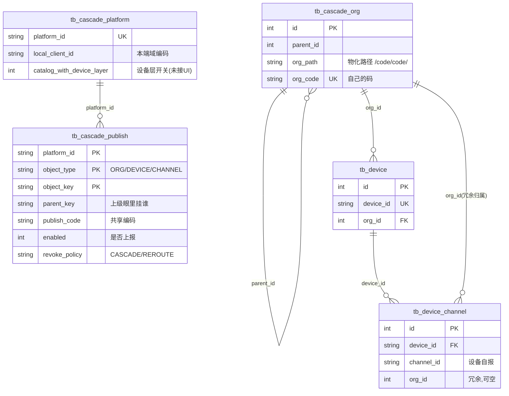
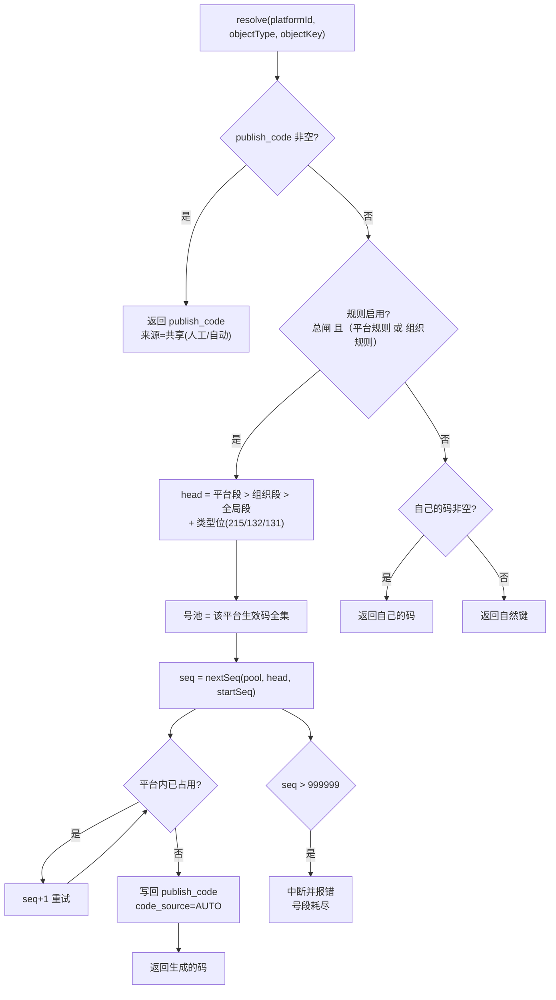
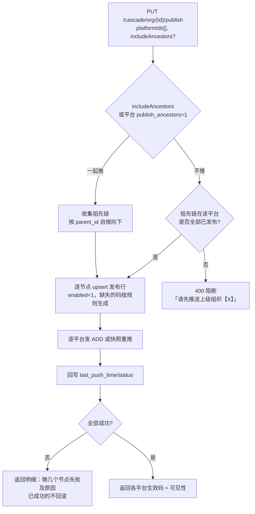
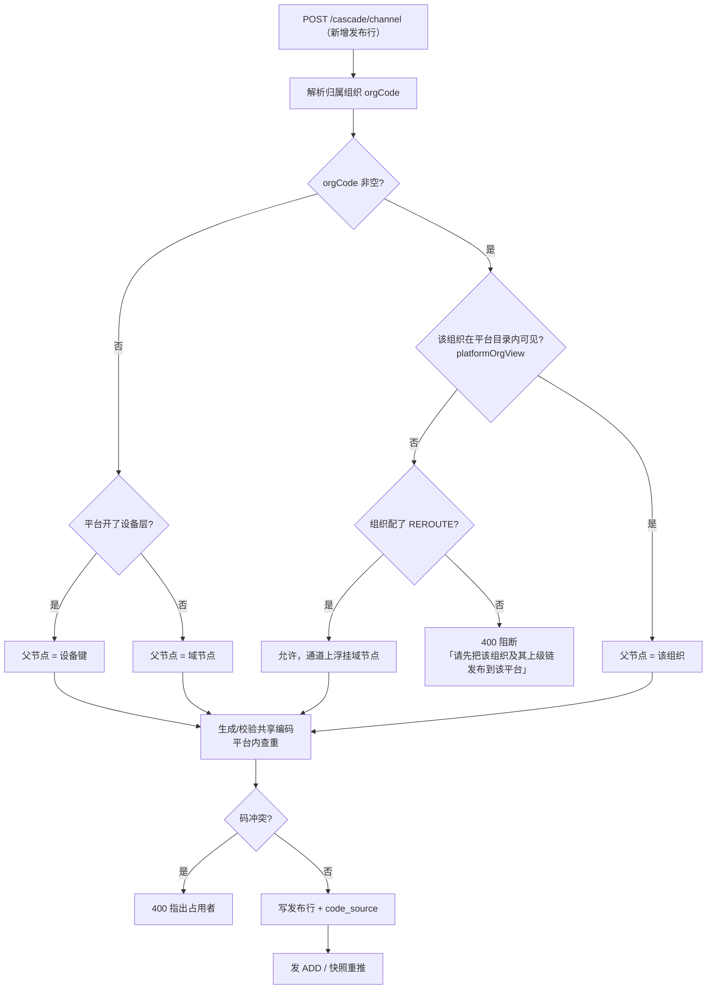
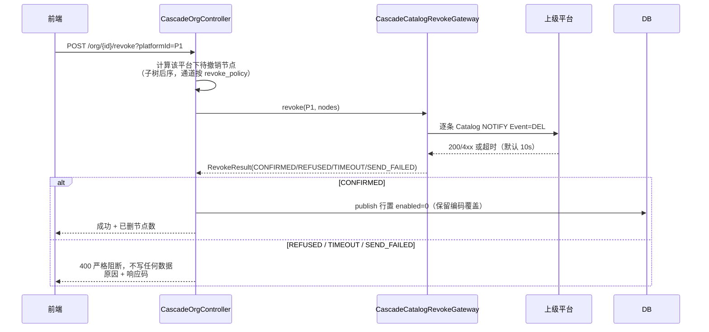
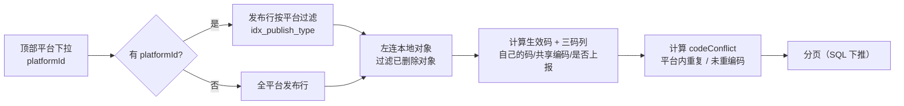

# 级联多平台发布与编码体系设计方案

| 项 | 内容 |
|---|---|
| 版本 | 1.10.3（草案 v1） |
| 状态 | 待评审（第 15 节有 6 个待定决策，评审后转「已定稿」） |
| 范围 | `tb_cascade_org` / `tb_device` / `tb_device_channel` / `tb_cascade_platform` / `tb_cascade_publish`，级联目录组装与撤销链路 |
| 不改动 | GB28181 报文格式、SIP 注册与心跳调度、录像/点播/PTZ 反查链路 |
| 关联文档 | `doc/1.10.1/CASCADE-THREE-TIER-ARCHITECTURE.md`、`doc/1.10.2/CASCADE-ASSET-PUBLISH-REMEDIATION.md`、`doc/AGENT-CONTEXT.md` §4.5 |

---

## 1. 背景与目标

### 1.1 一句话目标

> 一套本地资产（组织 / 设备 / 通道），可以同时上报给多个上级平台；**每个平台看到的编码、名称、层级、是否上报都可以不同**；编码按规则生成，**同一平台内绝不重复**。

### 1.2 要解决的现实问题

| 编号 | 问题 | 现状 |
|---|---|---|
| P1 | 同一台摄像机推给两个上级，需要两套编码 | 只能人工逐平台填 `publish_code`，没有规则、没有生成 |
| P2 | 用户勾了叶子组织，上级却看不到 | 祖先链未发布时节点被静默剔除，页面仍显示"推送中" |
| P3 | 从某个平台撤回，上级目录里的节点不消失 | 单平台撤回只改 `enabled`，不发 `DEL` |
| P4 | 给某平台改过编码后，停用/删除该组织，上级节点删不掉 | `DEL` 报文用的是本地编码，不是该平台的编码 |
| P5 | 通道没有"本地国标码"这一层 | 未配平台码时上报的是设备自报的 12 位通道号 |
| P6 | 平台内编码重复无法在页面发现 | 只有 DB 唯一键，且 `NULL` 时失效 |
| P7 | 设备层（域/组织/设备/通道四级）不可用 | 后端字段与组装器已具备，但**没有任何写入入口** |

### 1.3 不做什么

- 不引入第二棵组织树。本地只有一棵树，多平台是同一棵树的不同视图。
- 不引入 `org_platform` / `channel_platform` 关系表。N:N 由发布表表达（原因见 §6.4）。
- 不做跨实例分布式发号。单实例发号 + DB 唯一键兜底已足够，多实例场景留给后续。

---

## 2. 术语

| 术语 | 含义 | 落点 |
|---|---|---|
| **自己的码** | 本地为该对象分配的国标 20 位编码，与平台无关 | 组织 `tb_cascade_org.org_code`；通道 `tb_device_channel.code`（本期新增） |
| **共享编码** | 该对象在**某个**上级平台上的编码 | `tb_cascade_publish.publish_code` |
| **生效码** | 上级这一刻真正看到的编码 = `共享编码 ?: 自己的码 ?: 自然键` | 计算值，不落库 |
| **发布行** | 一条「某对象 → 某平台」的关系记录 | `tb_cascade_publish` 一行 |
| **可见性** | 对象能否出现在某平台目录中 = 自身与祖先链都已发布且本地启用 | `platformOrgView()` 派生 |
| **是否上报** | 该对象是否参与该平台的目录同步（`enabled`） | `tb_cascade_publish.enabled` |
| **撤销** | 让上级删除某节点，必须发 `Event=DEL` 并等 2xx | `CascadeCatalogRevokeService` |

---

## 3. 现状评估

### 3.1 现有表关系



关键约束（现状，保留不动）：

- `uk_cascade_org_code (org_code)` —— 本地组织编码全局唯一
- `uk_publish_object (platform_id, object_type, object_key)` —— 一个对象在一个平台只有一条发布行
- `uk_publish_code (platform_id, publish_code)` —— **跨 object_type**，与 GB28181「同一上级 DeviceID 唯一」一致
- `idx_publish_type (platform_id, object_type, enabled)`

### 3.2 需求能力矩阵

| # | 需求 | 现状 | 结论 |
|---|---|---|---|
| R1 | 组织树父子关系 | `parent_id` + `org_path` + 索引 | ✅ |
| R2 | 组织下有设备 | `tb_device.org_id` | ✅ |
| R3 | 设备下有通道，通道冗余组织便于查询 | `tb_device_channel.org_id` + `idx_channel_org` | ✅ |
| R4 | 上级平台表 | `tb_cascade_platform` | ✅ |
| R5 | 组织/通道可推给多个平台 | 发布表 N:N，目录按平台现算 | ✅ |
| R6 | 推子组织时父组织未推：**可选一起推/不推** | 硬编码为"不推"，且静默无提示 | ❌ 缺功能 |
| R7 | 推通道必须先推组织 | 已实现且更严：要求**整条祖先链**可见，否则抛错 | ✅ |
| R8 | 同组织推不同平台可用不同编码 | 表支持，组装闭环；但 `DEL` 用本地码 → 会漏删 | ⚠️ 半可用 |
| R9 | 同通道推不同平台可用不同编码 | 表支持，`DEL` 正确；但自动生成刻意跨平台复用同码 | ⚠️ 半可用 |
| R10 | 编码按规则生成 | 已有完整七段引擎，但只作用于**组织级本地码** | ⚠️ 缺平台维度 |
| R11 | 同一平台内编码不重复 | 仅 DB 唯一键；`publish_code` 为 `NULL` 时失效 | ⚠️ 有漏洞 |
| R12 | 三层编码展示（自己的码/共享编码/是否上报） | 数据齐备，列表未展示 | ⚠️ 缺展示 |
| R13 | 设备层（域/组织/设备/通道） | 组装器与字段已具备，无写入入口 | ❌ 半成品 |

### 3.3 已确认缺陷（代码位置）

| 缺陷 | 位置 | 影响 |
|---|---|---|
| D1 祖先链未发布 → 子组织静默消失 | `CascadeOrgManager#firstPlatformBlocker` L672-695 | 用户以为推了，上级看不到 |
| D2 `DEL` 用本地码 | `CascadeOrgManager#orgNode` L1335-1338 | 改过码的平台节点删不掉 |
| D3 单平台撤回不发报文 | `CascadePublishManager#configurePlatforms` L125-170 | 上级目录残留 |
| D4 发布动作不发报文 | `CascadeOrgController#configurePublish` L295-316 | 勾选后要等订阅周期或整树快照 |
| D5 `publish_code=NULL` 时唯一性失效 | `uk_publish_code` 语义 + 回落本地码 | 跨对象类型可能重号 |
| D6 设备层无写入入口 | `PublishObjectType.DEVICE` 仅出现在清理/读取 | 设备层不可用 |
| D7 通道自动码跨平台复用 | `LocalCascadeCodeRuleService#reusableCode` L229-237 | 与"每平台不同码"目标相反 |

---

## 4. 目标模型

### 4.1 三层编码

参考项目（CSS/CMS）的形态，也正是本项目要补的：

```
① 自然键（设备侧原始值）      100000211000            tb_device_channel.channel_id
② 自己的码（本地国标码）       51010200041311000123    tb_device_channel.code       ← 本期新增
③ 共享编码（平台维度）         53010200041311000123    tb_cascade_publish.publish_code
                              └──┬──┘
                          省市区段不同，后 12 位相同
```

- ② 与平台无关，一个对象一个值，**生成一次即固化**
- ③ 一个平台一个值，可自动生成、可人工覆盖
- 上级只看 ③；②的存在价值是"未配平台码时也能给出合规的 20 位码"，而不是退回 12 位自然键

### 4.2 生效码解析（唯一出口）



三条铁律：

1. **纯读只有一个口径**。目录组装、`DEL/REPARENT` 报文、列表展示、反查、查重全部走 `effectiveCode`，禁止各自读列。
2. **第 5 步必须落库**。不落库每次现算，号池一变码就漂（`deviceCode` 注释已记录此坑）。
3. **生成只发生在有落库位的地方**。号段耗尽直接报错；发布行不存在时回本地码而不硬算——没有固化位，算出来的码下次必然换一个。

实现上拆成两处（2.2 已落地）：

| 函数 | 职责 | 调用方 |
|---|---|---|
| `CascadeCodeResolver#resolve` | 没有码时按规则生成，并写回 `publish_code` + `code_source=AUTO` + `code_generated_time` | 只在「对象要上报到某平台」的入口（2.4 接入） |
| `CascadeCodeBuilder#effectiveCode` | 纯读：`publish_code ?: 自己的码`（通道取 `object_key` 的通道段） | 目录组装、`DEL` 报文、平台内查重、列表展示 |

两条不能合并：`DEL`/撤回路径若就地生成新码，删掉的是上级从没见过的节点。

**开关语义**取「总闸 且（平台规则 或 组织规则）」，而不是三方「∩」：只开了平台规则的部署（或反过来只开组织规则）
都应该出码，否则勾了开关却不见码只能翻源码才解释得清；而存量「组织规则已开」的用户也不会因为新增平台维度
集体退回本地码——退回等于上级目录整体换编号，且没有回滚通道。

### 4.3 可见性

```
可见 = 本地启用(自身 ∩ 祖先链)  ∩  (自身已发布 ∩ 祖先链已发布)
```

R6 的选择改变了"祖先链已发布"这一项的达成方式：

| 策略 | 行为 |
|---|---|
| `includeAncestors = true`（或平台默认开） | 自动把缺失的祖先链补推为 `enabled=1`，并逐平台发 `ADD` |
| `includeAncestors = false` | **前置校验**：祖先链不完整直接 400，明确指出缺哪一级 |

两种都不允许出现"静默不上目录"。

---

## 5. 数据模型变更总览

| 表 | 新增列 | 新增索引 | 目的 |
|---|---|---|---|
| `tb_device_channel` | `code` | `idx_channel_code` | 「自己的码」落库位 |
| `tb_cascade_platform` | `code_province/city/county/industry/network`、`code_start_seq`、`code_rule_enabled`、`publish_ancestors` | — | 平台级编码规则 + 父链推送策略 |
| `tb_cascade_publish` | `code_source`、`code_generated_time`、`device_key`、`last_push_time/status/message` | `idx_publish_parent`、`idx_publish_device` | 码来源标记、通道拆键、推送状态 |

> `parent_key` 列已通用（ORG/DEVICE/CHANNEL 都能用），只是当前只有 CHANNEL 在写。本期不新增父节点覆盖列。

---

## 6. 表结构设计

### 6.1 DDL（三方言一致，类型按方言微调）

```sql
-- ========== ① 通道：补「自己的码」 ==========
ALTER TABLE tb_device_channel ADD COLUMN code VARCHAR(64) DEFAULT NULL;
CREATE INDEX idx_channel_code ON tb_device_channel (code);

-- ========== ② 平台：编码规则 + 父链策略 ==========
ALTER TABLE tb_cascade_platform ADD COLUMN code_province     VARCHAR(2)  DEFAULT NULL;
ALTER TABLE tb_cascade_platform ADD COLUMN code_city         VARCHAR(2)  DEFAULT NULL;
ALTER TABLE tb_cascade_platform ADD COLUMN code_county       VARCHAR(4)  DEFAULT NULL;
ALTER TABLE tb_cascade_platform ADD COLUMN code_industry     VARCHAR(2)  DEFAULT NULL;
ALTER TABLE tb_cascade_platform ADD COLUMN code_network      VARCHAR(1)  DEFAULT NULL;
ALTER TABLE tb_cascade_platform ADD COLUMN code_start_seq    INTEGER     DEFAULT NULL;
ALTER TABLE tb_cascade_platform ADD COLUMN code_rule_enabled INTEGER     NOT NULL DEFAULT 0;
ALTER TABLE tb_cascade_platform ADD COLUMN publish_ancestors INTEGER     NOT NULL DEFAULT 0;

-- ========== ③ 发布行：码来源 / 拆键 / 推送状态 ==========
ALTER TABLE tb_cascade_publish ADD COLUMN code_source         VARCHAR(8)   DEFAULT NULL;  -- AUTO / MANUAL
ALTER TABLE tb_cascade_publish ADD COLUMN code_generated_time DATETIME     DEFAULT NULL;
ALTER TABLE tb_cascade_publish ADD COLUMN device_key          VARCHAR(64)  DEFAULT NULL;  -- CHANNEL 行冗余设备段
ALTER TABLE tb_cascade_publish ADD COLUMN last_push_time      DATETIME     DEFAULT NULL;
ALTER TABLE tb_cascade_publish ADD COLUMN last_push_status    VARCHAR(16)  DEFAULT NULL;  -- OK/FAILED/TIMEOUT/SKIPPED
ALTER TABLE tb_cascade_publish ADD COLUMN last_push_message   VARCHAR(255) DEFAULT NULL;
CREATE INDEX idx_publish_parent ON tb_cascade_publish (platform_id, object_type, parent_key);
CREATE INDEX idx_publish_device ON tb_cascade_publish (platform_id, object_type, device_key);
```

类型差异：

| 方言 | 说明 |
|---|---|
| SQLite | `DATETIME` 沿用现状；`ADD COLUMN` 不支持多列合并，逐条执行 |
| MySQL | `DATETIME NULL`；`INT NOT NULL DEFAULT 0` |
| PostgreSQL | `TIMESTAMP`；`ADD COLUMN IF NOT EXISTS` |

### 6.2 迁移与脚本清单

| 动作 | 文件 |
|---|---|
| 三方言全量建表 | `sql/voglander-sqlite.sql`、`sql/voglander.sql`、`sql/voglander-postgresql.sql` |
| 增量迁移（平台编码规则） | `sql/migration/{sqlite,mysql,postgresql}/1.10.3-cascade-platform-coding.sql`（§6.1 ②） |
| 增量迁移（发布行码来源） | `sql/migration/{sqlite,mysql,postgresql}/1.10.3-cascade-publish-code-source.sql`（§6.1 ③ 的 `code_source` + `code_generated_time`） |
| 增量迁移（通道码 + 拆键/推送状态） | `sql/migration/{sqlite,mysql,postgresql}/1.10.3-cascade-channel-code-push-status.sql`（§6.1 ① + ③ 的 `device_key/last_push_*`，含两个索引与存量 `device_key` 回填） |
| SQLite 启动期自动迁移 | `SqliteCascadeCodingSchemaMigrator`（②）、`SqliteCascadePublishCodeSourceMigrator`（③ 前两列）、`SqliteCascadeChannelCodePushStatusMigrator`（① + ③ 其余四列）；均对齐已有 `SqliteCascadePlatformLayerMigrator` 写法 |

> §6.1 的 ① 与 ③ 的 `device_key/last_push_*` 单独一支（迁移键 `cascade-channel-code-push-status`）：
> MySQL 的 `ADD COLUMN` 不支持 `IF NOT EXISTS`，一次性脚本不能事后追加内容（已执行过的库不会重跑），
> 与 2.2 的 `1.10.3-cascade-publish-code-source` 分开发布，两支可各自重放。
> 该支已随 2.4 落地：迁移器按 `pragma_table_info / sqlite_master` 幂等补列补索引，
> 并按 `PublishKeys.channelDeviceId` 口径（取第一个 `:` 之前）回填存量 `device_key`，脏键留空不猜。
>
> ③ 的 `code_source/code_generated_time` 已随 2.2 落地——固化与人工值保护（2.5）都需要它。

> SQLite 迁移器必须幂等：先查 `PRAGMA table_info` 判断列是否存在，再 `ALTER`。参考 `SqliteCascadePlatformLayerMigrator`。

### 6.3 为什么要 `device_key`

`object_key` 对通道是 `deviceId:channelId` 拼接。这带来两个问题：

1. 「某平台某设备下的通道」必须全表取回后 `split(":")` 内存过滤（现状 `getPage` 最后一步就是内存分页）。
2. 违反项目约定：**不能用字符串前缀/拼接推断标识**（GB28181 的 `deviceId` 本身可能含 `:`）。

加 `device_key` 后：`WHERE platform_id=? AND object_type='CHANNEL' AND device_key=?` 一次命中索引；`object_key` 保留为兼容键，不再参与查询条件。

### 6.4 为什么仍然不建关系表

有人会问：为什么不建 `tb_cascade_org_platform` 和 `tb_cascade_channel_platform`？

因为「对象 × 平台」这一行要携带的**平台相关属性**远不止"是否关联"：

```
publish_code  publish_name  sort_order  parent_key
enabled       revoke_policy  manufacturer/model/address/ip_address/ptz_type  code_source
```

拆成三张表就意味着这三组属性要各建一遍、各写一套维护接口、各做一次一致性校验。一张发布表 + `object_type` 判别，是这里的正确选择；它的问题（复合键语义、缺索引）已经用 `device_key` + 两个索引解决，不需要改结构。

---

## 7. 编码规则与生成算法

### 7.1 规则作用域（四级回落）

```
平台规则  >  组织规则  >  全局配置  >  硬兜底
```

| 层 | 配置位置 | 段位 | 说明 |
|---|---|---|---|
| 平台 | `tb_cascade_platform.code_*` | 省/市/县/行业/网络 + 起始序号 | 前 14 位必填（平台无父级，不做父级回落）；启用即五段必填，类型位由对象类型决定 |
| 组织 | `tb_cascade_org.code_*` | 省/市/县/行业/类型/网络 + 起始序号 | 允许留空 → 回落父组织（存量语义，保留） |
| 全局 | `gateway.cascade.code-prefix`(10) + `gateway.cascade.org-type` | 中心编码 + 行业 | 兜底 |
| 硬兜底 | `CascadeCodeBuilder.DEFAULT_*` | 340200 / 215 / 0 | 配置缺失时 |

**类型位不进平台规则**：组织 `215/216`、设备 `132`、通道 `131` 由对象类型决定。平台规则里若允许填类型位，通道就会以 `216` 开头——这是必须避免的误导。

### 7.2 生成算法

```java
String generate(String platformId, PublishObjectType type, String objectKey, String orgCode) {
    Segments platformSeg = segmentsOfPlatform(platformId);        // 可为 null
    Segments orgSeg      = segmentsOfOrg(orgCode);                // 可为 null
    Segments globalSeg   = globalCodeSegments();
    Segments seg = CascadeCodeBuilder.resolve(platformSeg, orgSeg, globalSeg);
    seg = seg.withType(typeOf(type));                             // 215/132/131

    String head     = seg.head();                                  // 前 14 位
    Integer startSeq = firstNonNull(platformStartSeq(platformId), orgStartSeq(orgCode));
    Set<String> pool = effectiveCodePool(platformId);              // 该平台生效码全集

    for (int seq = CascadeCodeBuilder.nextSeq(pool, head, startSeq);
             seq <= CascadeCodeBuilder.MAX_SEQ; seq++) {
        String code = CascadeCodeBuilder.join(head, seq);
        if (!pool.contains(code)) {
            return code;
        }
    }
    throw new IllegalStateException("号段耗尽：前缀 " + head + " 下 6 位序号已用尽，请调整前缀或起始序号");
}
```

### 7.3 平台内唯一的三道保障

| 层 | 机制 | 覆盖范围 |
|---|---|---|
| 生成期 | 号池 = 该平台**生效码**全集（含回落本地码的对象） | 自动生成不撞 |
| 落库前 | `assertCodeAvailable` 扩展为跨 `object_type` 查重（复用 `publishConflicts` 口径） | 人工填码被拦 |
| 落库时 | `uk_publish_code (platform_id, publish_code)` | 并发兜底，冲突后重试下一个号 |

> **必须按"生效码"查重**：`publish_code` 为 `NULL` 时 DB 唯一键不生效，而组装期会回落到本地码。只查列不查解析结果，等于漏掉整条回落路径（缺陷 D5）。

### 7.4 号池定义

```
effectiveCodePool(platformId)
  = 该平台所有 publish_code（非空）
  ∪ 该平台目录内所有对象的「自己的码」（非空）
  ∪ 该平台目录内所有对象的自然键
```

三个来源都要：只算发布行会漏掉"未配码但会上报"的对象；只算本地码会漏掉"已生成但未推"的对象。

### 7.5 不可变约束

| 约束 | 理由 |
|---|---|
| 生成即落库，不再重算 | 现算会漂 |
| 已上报的码不自动变更 | 上级侧历史录像、订阅、点播都用它做引用键 |
| 人工填写的码（`code_source=MANUAL`）不被自动逻辑覆盖 | 除勾选"覆盖已有编码" |
| 组织重编码（`reapply`）不动 `publish_code` | 现状已如此（`applyCodeReapply` 注释），保留 |
| 改码必须配对 `DEL`（旧码）→ `ADD`（新码） | 上级没有"改码"语义，只有删旧建新 |

> ✅ 2.5 已落地：写入侧统一标 `code_source=MANUAL`（组织发布覆盖 / 通道新增 / 通道编辑，均经 `CascadePublishManager#publish`，**改码与翻来源同一事务**）；判定收在 `CodeSource.isAuto/isManual`，**历史未标记行按「非 AUTO 即人工」处理**；组织重算不动 `publish_code`（连同来源两列）；`batchFill` 只补空列并把人工行计入 `manualProtected`；`fillCodeIfBlank` 对人工行不写入；`freezeCode` **只在 `publish_code` 仍为空时写入**（CAS），命中不了返回 `OCCUPIED`，`resolve`/`batchFill` 放弃该行而不是换号硬顶。显式的「覆盖已有编码」入口随阶段 3 的编码配置弹窗一起做。

---

## 8. 核心流程

### 8.1 组织发布到平台（含父链策略）



要点：

- 勾选变更的**同时也可能是撤回**（取消勾选的平台），撤回侧必须走「真撤销」（§8.3），不能只翻 `enabled`。
- 祖先链补推只补**缺失的那几级**，不覆盖已有行的编码与策略。
- 批量接口（`/disable/batch` 性质）逐条独立，单条失败不影响其余，结果逐条回传。

### 8.2 通道推送到平台（组织前置校验）



### 8.3 单平台撤回（两段式，新增）



两种放行例外（与删除链路同一口径）：`PLATFORM_ABSENT`（平台配置已不存在）、`sip.client.enabled=false`（出站 bean 缺失）。

### 8.4 删除资产（两段式，现状保留）

```
撤销（等 2xx） → 清发布行 → 清本地行
                  ↑ 任一平台未确认则整批不删，直接抛错
```

顺序不能反：先删本地会失去"要删哪些码"的依据。

### 8.5 按平台列表查询



筛选口径必须落在**生效码**上，不是发布行上：用户搜 `5301...` 时，未配码但本地码匹配的对象也要能搜到。

---

## 9. 接口设计

### 9.1 组织

| 方法 | 路径 | 变更 | 说明 |
|---|---|---|---|
| PUT | `/api/v1/cascade/org/{id}/publish` | **改** | body 增 `includeAncestors`；取消勾选的平台改走真撤销 |
| POST | `/api/v1/cascade/org/{id}/revoke` | **新增** | `?platformId=`，两段式撤销，失败严格阻断 |
| GET | `/api/v1/cascade/org/published` | **新增** | `?platformId=`，返回该平台真正可见的组织树（`platformOrgView`） |
| GET | `/api/v1/cascade/org/{id}/publish` | 改 | 出参增 `effectiveCode`、`codeSource`、`lastPush*` |
| POST | `/api/v1/cascade/org/{id}/code/reapply` | 保留 | 仅作用于本地 `org_code`，不动 `publish_code` |
| PUT | `/api/v1/cascade/platform/{id}/code-rule` | **新增** | 平台级编码规则（五段 + 起始序号 + 两开关，**整份覆盖**）；启用时前 14 位必填，类型位只读；`publish_ancestors` 不提交时保留库中现值；段位首尾空白在 Req 入口归一（空格=未填），VO 五段空串统一回 null。✅ 已落地（`CascadePlatformManager#updateCodeRule` + `assertCodeRuleValid`） |

### 9.2 通道

| 方法 | 路径 | 变更 | 说明 |
|---|---|---|---|
| POST | `/api/v1/cascade/channel/getPage` | **改** | body 增 `platformId`、`sharedCodeExists`、`sharedCode`、`codeConflict` |
| POST | `/api/v1/cascade/channel` | 改 | 出参增三码；码由规则生成时回填 `code_source=AUTO` |
| POST | `/api/v1/cascade/channel/{id}/revoke` | **新增** | 与组织撤销同口径 |
| POST | `/api/v1/cascade/channel/batch-publish` | **新增** | 批量推送多通道到多平台，逐条回传结果 |

### 9.3 列表出参（组织与通道统一）

```json
{
  "id": 12,
  "localCode": "51010200041311000123",   // 自己的码
  "sharedCode": "53010200041311000123",  // 共享编码（可为空）
  "effectiveCode": "53010200041311000123",
  "codeSource": "AUTO",                  // AUTO / MANUAL / INHERIT
  "platformId": "css89",
  "shared": true,                        // 是否上报
  "codeConflict": "NONE",                // NONE / DUPLICATE / NOT_RECODED
  "conflictWith": null,                  // 冲突对象描述
  "lastPush": { "time": 1762300000000, "status": "OK", "message": null }
}
```

`codeConflict` 判定：

| 值 | 判定 | UI 建议 |
|---|---|---|
| `NONE` | 平台内唯一，且与自己的码不同 | 正常 |
| `DUPLICATE` | 该平台内生效码与其它对象重复 | 红色，阻断上报 |
| `NOT_RECODED` | 共享编码 == 自己的码 | 灰色提示，不算错误 |

### 9.4 编码相关（运维）

| 方法 | 路径 | 说明 |
|---|---|---|
| POST | `/api/v1/cascade/code/generate` | 为指定对象×平台生成码，`dryRun` 返回预览 |
| POST | `/api/v1/cascade/code/batch-fill` | ✅ 批量补齐"已发布但无共享码"的行（`platformId` + `objectType` + `dryRun`，**默认 `true`**），返回变更清单与冲突；人工码（`code_source` 非 AUTO）跳过并计入 `manualProtected`，不参与重算 |
| POST | `/api/v1/cascade/code/check` | 平台内编码自检（重复、跨类型碰撞、号段余量） |

---

## 10. 前端设计

### 10.1 列表页（组织 / 通道共用形态）

```
┌─────────────────────────────────────────────────────────────┐
│ [上级平台 ▼ css89]                              [编码配置]   │
├─────────────────────────────────────────────────────────────┤
│ 搜索：名称/编码   [共享码是否存在 ▼] [共享编码____] [查询]   │
├──────────────┬──────────┬────────┬────────┬─────┬────────────┤
│ 自己的码      │ 通道名称  │ 所属组织│ 是否上报│共享码│ 双码重复  │
│ 5101020004.. │ 海康IPC  │ 默认/100│  ●是   │5301..│  否       │
└──────────────┴──────────┴────────┴────────┴─────┴────────────┘
```

要点：

- 平台未选中时，展示"全平台"聚合视图，`是否上报` 列显示为"N 个平台中 M 个"。
- `共享编码` 列必须显示**生效码**（空值时显示灰色占位"沿用 510102…"），不能让用户以为上级看到的是空。
- `是否上报` 用开关直接改，但走 §8.3 的两段式（先在确认框里说明会向哪个平台发 `DEL`）。

### 10.2 编码配置弹窗

```
┌─ 编码配置 ── 已选择 1 个组织 ────────────────────────────┐
│ 上级平台：[css89 ▼]                                      │
│ * 编码规则（前 14 位必填）                                │
│   [37][01][0200][04][216][1]  ← 6 段，段间视觉分隔         │
│   起始序号 [000123]   ← 与上面分开，明确是"发号起点"        │
│   ☐ 覆盖已有编码（平台内已上报的码也会被改写，需二次确认）  │
│                                                          │
│ 预览：51010200041311000123 → 53010200041311000123        │
│ 冲突：0 处                                                │
└──────────────────────────────────────────────────────────┘
```

三条交互约束（对应易错点）：

1. **起始序号独立展示**，不要和 14 位拼成 20 个连续格子——否则用户会以为填的就是该对象的最终序号。
2. **类型位按对象类型只读**：组织 215/216、设备 132、通道 131。
3. **"覆盖已有编码"必须二次确认**，并在确认框里列出将被改写的对象数与平台。

### 10.3 发布抽屉（组织）

- 每平台一行：`勾选` `生效码(只读回显)` `手工编码(可填)` `名称` `通道策略` `最近推送状态`。
- 底部加父链策略：`[✓] 父组织未推送时一并推送`（默认取平台配置）。
- 保存时若存在"父链缺失且未勾选"，前端直接拦截并列出缺失节点，不等后端 400。

---

## 11. 补充需求（行业经验，用户未提及）

以下 12 条来自同类级联产品的常见诉求，按"不做会立刻被现场问到"的程度排序。

### 11.1 目录自检 / 对账（P0，强烈建议）

**问题**：上级目录与本端发布集是两套状态，任何一次报文丢失都会长期漂移，而现场只能靠"上级那边少了一台设备"来发现。

**做法**：
- 提供"上级视角快照"接口：把 `platformOrgView` + `resolveCode` 的结果原样导出成节点清单（编码/名称/父编码/状态）。
- 提供"差异检测"：对比本端快照与「上次成功推送快照」（后者落一张轻表或发布行的 `last_push_*`），列出"该有但没有 / 有但该删"。
- 支持"重推整树"按钮，走已有 `pushCatalogSnapshot`。

**价值**：把"上级看不到"从口头报障变成一次点击可查。

### 11.2 僵尸发布行巡检（P0）

**问题**：本地对象已删、发布行还在（或反之），`platformOrgView` 只能跳过，日志里看不出来。

**做法**：巡检任务定期扫描：`CHANNEL` 行的 `object_key` 找不到本地通道、`ORG` 行的 `org_code` 找不到组织、`publish_code` 重复。输出清单 + 一键清理（清理前必须能确认上级已无该节点）。

### 11.3 编码冲突一键修复（P1）

**问题**：批量导入或历史数据很容易撞码，人工逐条改不可能。

**做法**：自检接口返回冲突组 → 每组保留一条、其余重新发号（`dryRun` 先预览）。修复动作必须走 `DEL(旧)` + `ADD(新)`。

### 11.4 批量补齐共享码（P1）

**问题**：升级后存量 `publish_code` 大量为空，逐个点不现实。

**做法**：`/code/batch-fill` 按"平台 × 类型"分批生成，返回变更清单与冲突，支持 `dryRun`。**必须默认 `dryRun=true`**——一次性给上千个已在上级生效的对象换码是高风险动作。

### 11.5 导入 / 导出（P1）

参考项目列表右上角有这两个按钮，现场确实会用：
- **导出**：当前筛选条件下的三码 + 是否上报，Excel/CSV；用于甲方对账。
- **导入**：只允许导入"共享编码 + 是否上报"两列（按"自己的码"或"通道ID"匹配），不允许导入组织结构和本地码——那属于另一类操作，误导入代价极高。

### 11.6 变更审计（P1）

**问题**：同一台设备昨天还能点播、今天上级说没这个编码，需要能回答"谁在什么时候改了码"。

**做法**：对 `publish_code` / `enabled` / `parent_key` 三个字段的变更落审计（对象、平台、旧值、新值、操作人、来源 AUTO/MANUAL、时间）。表可以复用现有的业务任务/日志表，也可以新增 `tb_cascade_publish_audit`。

### 11.7 推送状态与失败重试（P1）

**问题**：现在 `pushCatalogSnapshot` 发出去了就算完成，失败只在日志里。

**做法**：用本次新增的 `last_push_*` 三列记录结论；列表页展示"最近推送：3 分钟前 / 成功"；对 `FAILED/TIMEOUT` 提供手动重试。异步重试要防抖（同一平台 5s 内合并成一次）。

### 11.8 上级可见性预览（P1）

**问题**：用户点"停用"时最想知道的是"上级那边会少掉什么"。

**做法**：已有 `/disable/preview`（组织）和 `revoke-preview`（通道策略），把它扩展到"单平台撤回"和"改码"两个动作上——改码的预览要明确列出"将删旧节点 N 个、新增节点 N 个"。

### 11.9 平台离线/未注册时的闸门（P2）

**问题**：平台离线时点"上报"，报文发不出去，用户看到"成功"还是"失败"取决于实现细节。

**做法**：统一用 `CascadeDeliveryGate` 判断（已存在）：离线时上报/撤销操作返回明确警告，撤销仍按严格阻断处理（与删除链路一致），并在列表里给平台状态打标。

### 11.10 性能与容量（P2）

- 通道列表：用 `device_key` 把内存分页改成 SQL 分页（当前 `getPage` 最后一步是 `subList`）。
- 平台内生效码集合不要每次全量：按 `platform_id` 取，并考虑 `code` 前缀查询走索引。
- 组织树：`platformOrgView` 每次全量扫描组织表 + 发布表，对象数上千后可加 5~10s 缓存 + 写操作主动失效（对齐 Manager 层既有缓存失效模式）。

### 11.11 权限与菜单（P2）

新增动作需要独立权限码：编码配置（`cascade:org:code`）、撤回（`cascade:org:revoke`）、批量补齐（`cascade:code:batch`）、目录自检（`cascade:catalog:check`）。按项目规范，菜单与权限码要同步两份初始化 SQL + 现有 `app.db` 即时生效。

### 11.12 可观测性（P2）

- 指标：各平台 `push_success/fail/timeout` 计数、号段余量（各 head 已用序号/上限）、码冲突数。
- 日志：撤销/删除链路已有 `callId` 追踪，改码动作也要带上 `objectKey + platformId + 旧码 + 新码` 四要素。
- 错误码：把"父链未发布""码冲突""号段耗尽""上级未确认"四类错误区分为可识别的错误码，前端据此给不同引导（而不是都弹一个 message）。

---

## 12. 实施计划

四个阶段，每阶段可独立上线、可独立回滚。

### 阶段 1：修缺陷（不新增功能，风险最低）— ✅ 已落地

| 项 | 内容 | 验收 | 状态 |
|---|---|---|---|
| 1.1 | `DEL`/`REPARENT` 改用生效码（修 D2） | 给组织配平台码 → 停用 → 上级节点确实删除（lab 自环实测） | ✅ `CascadeOrgManager#platformOrgNodes` + `CascadeAssetCleanup#collectNodes` |
| 1.2 | 单平台撤回走两段式（修 D3） | 取消勾选 → 上级收到 `DEL` → 2xx 后才置 `enabled=0` | ✅ `POST /api/v1/cascade/org/{id}/revoke?platformId=` |
| 1.3 | 父链缺失从"静默"改为"报错"（修 D1，先不做自动补推） | 勾选叶子组织保存 → 400 并指出缺失祖先 | ✅ `CascadeOrgManager#assertAncestorsPublished` |
| 1.4 | 平台内生效码查重（修 D5 的校验侧） | 手工填重复码 → 400 指出占用者 | ✅ `CascadePublishManager#assertCodeAvailable`（按生效码，跨类型） |

> 1.3 只做"阻断"不做"自动补推"，是为了先把"静默"这个最坏情况消掉，补推逻辑在阶段 2 与策略字段一起上。
>
> 回归用例：`voglander-web/src/test/java/io/github/lunasaw/voglander/manager/cascade/CascadePlatformCodeTest.java`（7 条）。

### 阶段 2：编码能力

| 项 | 内容 | 状态 |
|---|---|---|
| 2.1 | 表变更（§6.1）+ 三方言 SQL + `SqliteCascadeCodingSchemaMigrator` | ✅ 全量：②`tb_cascade_platform` 8 列（`SqliteCascadeCodingSchemaMigrator` + `1.10.3-cascade-platform-coding.sql`）；③ 的 `code_source/code_generated_time`（`SqliteCascadePublishCodeSourceMigrator` + `1.10.3-cascade-publish-code-source.sql`）；① `tb_device_channel.code` 与 ③ 的 `device_key/last_push_*`（`SqliteCascadeChannelCodePushStatusMigrator` + `1.10.3-cascade-channel-code-push-status.sql`，含索引与 `device_key` 回填） |
| 2.2 | `CascadeCodeResolver`（三级解析 + 平台号池 + 固化落库），收口所有取值点 | ✅ `CascadeCodeResolver` 负责「生成 + 固化」；纯读口径收在 `CascadeCodeBuilder#effectiveCode`，ORG/DEVICE/CHANNEL 五处取值点与 `publishConflicts` 已切换 |
| 2.3 | 平台编码规则接口与校验（前 14 位必填、类型位只读） | ✅ ① 接线：`tb_cascade_platform` 八列已贯通 DO/DTO/Create·Update·CodeRule Req/VO/WebAssembler；② 校验：`CascadePlatformManager#assertCodeRuleValid` 收口“启用即五段必填 + 段位宽 + 开关 0/1 + 起始序号 0..999999”，新增/通用更新（按“库中现值 + 本次提交”合并校验）/规则保存三条写入路径共用；**类型位不进任何平台入参**（Req 无 `codeType` 字段，用例用反射钉死）；③ 接口：`PUT /cascade/platform/{id}/code-rule` 整份覆盖可清空段与关开关，不重启注册调度、不改写既有上报编码；保存恒返回成功（不看 affectedRows——MySQL 对「命中但无值变化」的 UPDATE 返回 0，拿它当结论会让重复保存显示失败）；`publish_ancestors` 是整份覆盖的唯一例外，未提交时保留库中现值；Controller 不预检平台存在性（存在性由 Manager 的 `Assert` 抛 IAE，与缺段/位宽错误走同一个 catch，文案只一份）；段位在 Req 入口 `trim`（`"  "` 按未填，避免 `@Pattern` 与 Manager 判定相反），VO 五段 `trimToNull`（通用更新可能写入的空串与规则保存的 NULL 对外都是 null）；库里「未配置」只留 NULL 一种表示——`add` 落库前、通用 update 的空白段都显式归一为 NULL（update 的归一排在 `updateById` 之后再补一次显式 SET：它的 null 是「不改」，提前归一会让「清空某段」静默失效）；④ 优先链：`CascadeCodeResolver` 按“平台段 → 组织段 → 全局段”逐段回落（2.2 已落地，本轮补测试钉住“平台段整体压过组织段、类型位仍取对象类型”）；⑤ 两个开关建表即 0，不传即 0，存量平台行为不变；`publish_ancestors` 本轮只做存取，消费逻辑随阶段 3.4 发布抽屉 |
| 2.4 | 生成入口：组织发布建行、通道新增、批量补齐 | ✅ ①`CascadeOrgManager#add` / `CascadeOrgController#configurePublish` 在建行（含人工覆盖写入）之后调 `resolveAll`；②`CascadeChannelManager#add` 改为「建空行 → `resolve` → `fillCodeIfBlank`」，保住按码反查；③`POST /cascade/code/batch-fill`（`CascadeCodeResolver#batchFill`，预览同样占号）。`code_source=MANUAL` 标记已随 2.5 落地 |
| 2.5 | `code_source` 保护：人工值不被自动覆盖，除非显式“覆盖已有编码” | ✅ ①写入侧：`CascadePublishManager#publish` 对「新值」标 `MANUAL` 并清空 `code_generated_time`，**值未变不翻来源**（前端回显原值再保存不能把 AUTO 变成人工值）；②判定：`CodeSource.isAuto/isManual`，空值按人工；③组织重算：`applyCodeReapply` 只改 `org_code/object_key/parent_key`，`publish_code` 与来源两列不动；④`batchFill` 只补空列、人工行计入 `manualProtected`；⑤`fillCodeIfBlank` 对 `MANUAL` 行不写入；⑥生成侧 `freezeCode` 带「`publish_code` 仍为空」CAS，返回 `WRITTEN/DUPLICATE/OCCUPIED` 三态，`resolve` 命中 `OCCUPIED` 回读现值、`batchFill` 计入 `manualProtected`，不再把「行已被写入」当撞键换号；⑦`publish` 的改码与翻来源同一事务，避免留下「人工码 + AUTO 来源」。显式「覆盖已有编码」入口随阶段 3 的编码配置弹窗落地 |
| 2.6 | 组织侧编码段与平台侧同口径归一（B-4） | ✅ ①入口：`CascadeOrgCreateReq` / `CascadeOrgUpdateReq` 六段（省/市/县/行业/**类型**/网络）手写 setter 做 `trim`——`trim(null)==null` 保住 patch 的三态（null=不改、`""`=清空、有值=写入）；组织侧比平台侧**多一段类型位**（平台侧类型由对象类型决定、不进平台入参），所以是六段不是五段；②出参：`CascadeWebAssembler#toVO` 六段 `trimToNull`，前端只判一种「未配置」；③落库：`CascadeOrgManager#add` 在 `toDO` 后六段 `trimToNull`，`update` 沿用平台侧「先 `updateById` 再补一次显式 SET」的双写（写法与理由同 2.3）；④`applyCodeRule` **刻意保持纯透传**——它就是 `''` 落库的来源，在这里 `trimToNull` 会让「清空某段」被 `updateById` 当成「没传」吞掉；发号侧 `CascadeCodeBuilder#resolve` 本来就逐段 `trimToNull`，无需另改 |

> **调用方口径（2.6 起）**：组织编码六段（`codeProvince` / `codeCity` / `codeCounty` / `codeIndustry` / `codeType` / `codeNetwork`）的「未配置」对外统一为 `null`——库里是 `''` 还是 `NULL`、提交时是 `"  "` 还是 `""`，出参都一样。写入语义不变：`null`=不改、`""`=清空、有值=写入。已按 `?? ''` / `!= null` 判空的客户端无感知；按严格 `=== ''` 判「未配置」的脚本需改成判 `null`。
>
> **待人工确认**：正式前端仓库不在本仓（`.fe-staging` 只是补丁副本），需在正式 FE 仓检索这六个字段，确认没有 `=== ''` / `!== ''` 这类「未配置」判定；`.fe-staging` 现状已确认是 `?? ''` 与 `!= null` 形式。

验收：同一通道推两平台 → 两套不同前缀的 20 位码；平台内不重复；重启后码不变。

> 2.2 / 2.4 / 2.5 回归用例：`CascadeCodeResolverTest`（9 条，含建行即固化与 `batchFill` 预览占号）、
> `CascadeCodeSourceProtectionTest`（8 条，钉住人工码标记、历史未标记行、组织重算不动共享码、通道新增/编辑、批量补齐与 `freezeCode` 只写空列）、
> `CascadeChannelCodeDerivationTest`（4 条，钉住「建空行 → resolve → 回填」时序）、
> `SqliteCascadePublishCodeSourceMigratorTest`（5 条）、`SqliteCascadeChannelCodePushStatusMigratorTest`（6 条）；
> 2.3 回归用例：`CascadePlatformCodeRuleTest`（16 条，钉住两开关默认 0、平台段驱动前 14 位、平台段压过组织段、两平台两套前缀、启用缺段/段位宽拦截、patch 合并校验、启用态清空段被拒、规则保存空串段被拒、重复保存仍报成功、父链开关未提交不静默清零、整份覆盖关闭规则不改写既有码、创建的空白段落库为 NULL、停用态 patch 清空某段落 NULL 而非空串）、
> `CascadePlatformReqValidationTest` 新增 12 条（段位宽、空串清空、空格归一、首尾空白、起始序号与开关越界、`codeType` 不存在）、`CascadePlatformControllerTest` 新增 5 条（端点、平台不存在走 Manager IAE 且不预检、缺段回可读原因、VO 空串归一、JSON 首尾空白在反序列化时经 setter 归一）；
> 2.6 回归用例：`CascadeOrgCodeRuleTest` 新增 2 条（创建的空白段/空串落库为 NULL 且有值段只去空白、patch 清空某段落 NULL 且未提交段保持原值）、`CascadeOrgControllerTest` 新增 3 条（新增/编辑请求 JSON 首尾空白经 setter 归一且空串仍为「清空」、详情 VO 六段空白归一为 null）；
> `Cascade*` 全量 430 条通过。

### 阶段 3：界面与视图

| 项 | 内容 |
|---|---|
| 3.1 | 列表加平台下拉 + 三码列 + 是否上报 + 双码重复（组织与通道两套） |
| 3.2 | 组织接口补 `platformId`（`/published`） |
| 3.3 | 编码配置弹窗加平台维度 |
| 3.4 | 发布抽屉加父链策略选项 + 生效码回显 |
| 3.5 | 组织/通道 `getPage` 改 SQL 分页（`device_key` 生效） |

### 阶段 4：运维能力（按需取舍）

目录自检、僵尸行巡检、导入导出、变更审计、推送状态与重试、权限码与菜单、指标。

> 批量补齐（§11.4）已随 2.4 提前落地（`/cascade/code/batch-fill`）；阶段 4 只剩页面入口与权限码。

### 顺序理由

1 → 2 是"先止血再增强"：阶段 1 全是 bug 修复，不依赖新表；阶段 2 才动结构。3 依赖 2 的数据。4 可以随时插入或延后。

---

## 13. 测试方案

| 层次 | 覆盖点 |
|---|---|
| 单元（不启库） | `CascadeCodeBuilder` 段回落/拼位/`nextSeq` 边界（999999、跨网络位、脏数据）；`resolve` 四级回落优先级 |
| Manager（`@SpringBootTest` + `BaseTest`） | 生成即固化（两次调用同值）；平台内号池隔离（两平台同规则得不同号）；人工值不被覆盖；号段耗尽抛错 |
| 集成（`@SpringBootTest(RANDOM_PORT)` + `CascadeRevokeTestConfig`） | 单平台撤回成功/拒绝/超时三态；删除链路两段式；父链补推顺序（自根向下） |
| 报文级 | `DEL` 用的是生效码而非本地码（断言 `catalogEventNotify` 的 `DeviceID`）；`REPARENT` 的 `ParentID` 是平台码 |
| 前端 | `vue-tsc` + `vitest`；平台切换后列值变化；`NOT_RECODED` 与 `DUPLICATE` 的样式区分 |
| 回归基线 | 全量 `mvn test` 需排除 `LocalImageStorageServiceTest`（Windows 无符号链接权限，见 `doc/AGENT-CONTEXT.md` §8） |

必测的三条"防回归断言"：

1. 给组织配平台码 → 停用 → 断言 `DEL` 报文里的 `DeviceID` 等于**平台码**。
2. 同一通道推两平台、规则不同 → 断言两个 `publish_code` 不同且都 20 位。
3. `publish_code` 为 `NULL` 且本地码与其它对象重复 → 断言接口返回 `DUPLICATE`。

---

## 14. 兼容与风险

| 风险 | 说明 | 处置 |
|---|---|---|
| 存量编码漂移 | 升级后若默认开启平台规则，已上报对象的码会变，上级侧全部变"新设备" | **默认 `code_rule_enabled=0`**；规则只影响后续生成 |
| `publish_ancestors` 默认值 | 默认开会自动把祖先链推给上级，可能一次放出大量节点 | 默认 **0（不自动推）**，由用户显式勾选 |
| 表变更 | 三种方言 + SQLite 迁移器，漏一处会导致启动失败 | 迁移器幂等 + 启动自检；三方言脚本纳入 CI 校验 |
| 生效码解析收口 | 一次性替换 5 处取值点，遗漏会导致"页面显示"与"报文发出"不一致 | 先加 `CascadeCodeResolver` 与旧逻辑并行断言（同一输入必须同值），再切换调用方 |
| 组织重编码 | `reapply` 会改 `object_key` 与 `parent_key`，但与 `publish_code` 无关 | 保持现状"不动 `publish_code`"，并在文档与页面提示中写明 |
| 多实例发号 | 两个实例同时发号可能撞（唯一键兜底后会失败） | 本期只支持单实例；多实例时要求 DB 唯一键冲突后重试，或外部发号器 |
| 设备层 | 若阶段 4 才做，`catalog_with_device_layer=1` 的平台目录里不会有设备节点 | 在页面明确禁用该开关，避免用户配了不生效 |

---

## 15. 决策清单（已拍定）

全部按“建议”列定稿。阶段一已按 Q4=A 落地（父链缺失即报错，不自动补推）。

| # | 决策点 | 选项 | 建议 | 结论 |
|---|---|---|---|---|
| Q1 | 平台规则粒度 | A. 完整段位（省市区行业网络+起始序号）<br>B. 10 位前缀 + 起始序号 | **A**（参考项目证实改的是省市区段，B 表达不了） | **A** |
| Q2 | 平台规则默认是否启用 | A. 默认关<br>B. 默认开 | **A**（避免存量换码） | **A** |
| Q3 | 「自己的码」谁生成 | A. 本地按规则生成并落库<br>B. 用设备自报的 `channel_id` | **A**（否则这一层没有存在意义） | **A** |
| Q4 | 父链策略默认值 | A. 默认不自动推（缺失即报错）<br>B. 默认自动补推 | **A**（B 会一次放出大量节点） | **A**（阶段一已落地） |
| Q5 | 「双编码重复」判定 | A. 只查平台内重复<br>B. 同时提示"共享码 == 自己的码" | **B**（两者动作不同，分开提示） | **B** |
| Q6 | 本轮范围 | A. 阶段 1+2+3<br>B. 再加阶段 4 的 P0 两项（目录自检、僵尸巡检） | **B**（这两项是"上级看不到"的兜底） | **B** |

---

## 附：与参考项目（CSS/CMS）的列级对应

| 参考项目 | voglander 字段 |
|---|---|
| 上级平台下拉 | 请求参数 `platformId`（通道已支持，组织待补） |
| 自己的码 | `tb_cascade_org.org_code` / `tb_device_channel.code`（新增） |
| 通道ID | `tb_device_channel.channel_id` |
| 通道名称 / 所属组织 / 通道类型 / 在线状态 | `name` / `org_id`（+ 组织名） / 设备通道元数据 / 实时状态 |
| 是否上报 / 共享状态 | `tb_cascade_publish.enabled` |
| 共享编码 | `tb_cascade_publish.publish_code` |
| 双编码重复 | 计算列 `codeConflict`（不落库） |
| 编码配置 | 平台规则（`tb_cascade_platform.code_*`）+ `publish_code` 写入 |
| 共享编码是否存在 / 请输入共享编码 | `getPage` 新增两个查询条件 |
| 导入 / 导出 | 阶段 4 |
