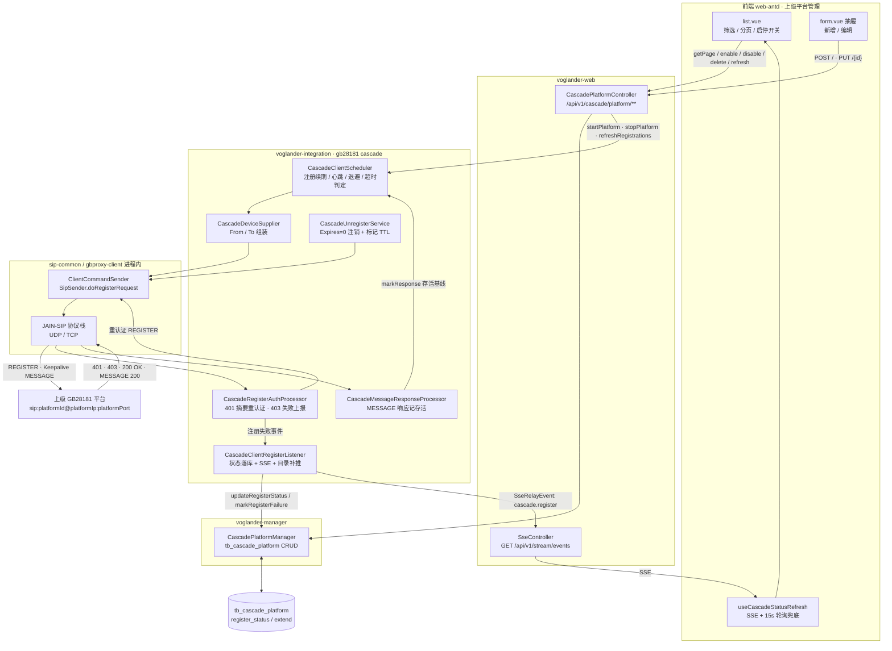
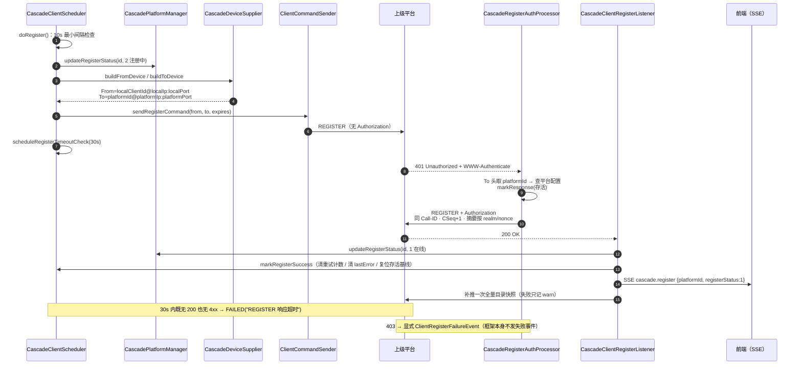
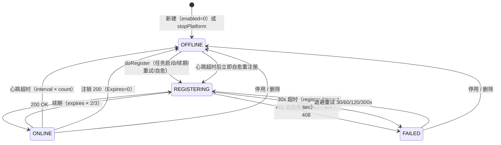
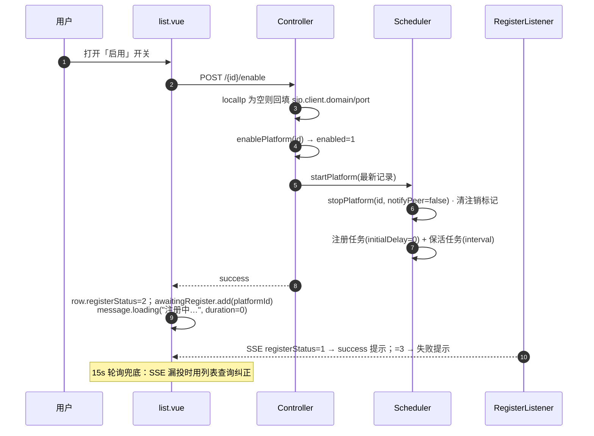

# 上级平台管理 · 平台注册全链路

> 范围：本平台作为 **GB28181 下级（客户端角色）**，向「上级平台」发起 REGISTER、续期、保活、注销的
> 完整链路——前端页面 → Web 接口 → 调度器 → SIP 协议栈 → 上级平台 → 状态回写与前端实时刷新。
>
> 事实来源：结论取自当前代码 + 2026-11-05 本机全栈实测（浏览器 + API + SIP 抓包，记录见 §9）。
> 改动这条链路时请同步本文（见 §8）。
>
> 报文口径：§5 的报文取自 `%USERPROFILE%\logs\voglander\voglander-sip.log` 的**真实收发记录**
> （上级 = 海康 NCG `192.168.106.35:7100`）。若与「按代码推导」的旧示例冲突，一律以 §5 抓包为准。
>
> 关联文档：`doc/1.0.11/CASCADE-REGISTER-FLOW-COMPARISON.md`（与 CSS 的逐阶段协议对比）、
> `doc/1.0.11/CASCADE-PLATFORM-SECURITY-HARDENING.md`（凭据与鉴权加固）。

---

## 0. 这份文档能回答什么

| 问题 | 章节 |
| --- | --- |
| 页面上每个字段最终变成哪条 SIP 报文的哪一段 | §1.3、§5.4 |
| 前端点了「新增 / 启用 / 停用 / 删除 / 刷新调度」分别请求什么接口、带什么参数 | §3、§4.4 |
| 注册是谁在驱动、多久一次、失败了多久重试 | §4.2、§4.5 |
| 为什么必须回 401 再重发、摘要怎么算 | §5.3、§5.5 |
| 上级回 403 / 404 / 超时，平台卡在什么状态、提示写在哪 | §6 |
| 涉及哪些外部服务、需要哪些配置项 | §2 |
| 找不到日志关键词时该看哪个类 | §7 |

---

## 1. 角色与地址约定

### 1.1 谁是谁

```
        ┌────────────────────────────┐          REGISTER / Keepalive MESSAGE          ┌──────────────────────┐
        │  voglander（下级 / 客户端） │ ─────────────────────────────────────────────► │  上级 GB28181 平台   │
        │  sip.client                │ ◄───────────────────────────────────────────── │  （海康 iSC / CSS…） │
        └────────────────────────────┘        401 → 带 Authorization 重发 / 200 OK      └──────────────────────┘
```

| 术语 | 含义 | 出现在报文哪里 | 对应表列 |
| --- | --- | --- | --- |
| `localClientId` | **本端**客户端国标 ID（20 位），上级侧登记的「设备编码」 | From / Contact / Keepalive 的 `DeviceID` | `tb_cascade_platform.local_client_id` |
| `localIp` / `localPort` | 本端**对外通告**地址，必须在上级可达 | Via / From / Contact | `local_ip` / `local_port` |
| `platformId` | **上级**平台国标 ID（20 位） | Request-URI / To | `platform_id` |
| `platformIp` / `platformPort` | 上级信令地址（默认端口 5060） | 目标地址、To 的 host | `platform_ip` / `platform_port` |
| `platformDomain` | 上级 SIP 域（缺省取 platformId 前 10 位） | `ToDevice.realm` | `platform_domain` |
| `platformName` | 平台名称，**只给本地人看** | **不进报文** | `platform_name` |
| `username` / `password` | 上级「鉴权登录名 / 鉴权密码」，用于 401 摘要 | `Authorization`（不是 From） | `username` / `password` |

三个容易混的点：

1. **`platformName` 与 `username` 无关**。前者是本列表里给人看的名字（可留空，列表回落显示 `platformId`）；
   后者只在 401 摘要里作为 `username="…"` 出现。
2. **From/Contact 的用户部分永远是 `localClientId`**，不是 `username`。上级认可的是「本端编码 + 密码」这一对，
   而不是表单上的登录名——登录名只决定摘要计算时的 `username` 入参。
3. **`localIp` 是通告地址，不是监听地址**。监听绑定是 `sip.client.listen-ip`（默认 `0.0.0.0`），
   而报文里的 `localIp` 取 `sip.client.domain`，必须是上级可回包的地址。

### 1.2 三条地址来源与回填规则

| 场景 | `localIp` / `localPort` 为空时 |
| --- | --- |
| 新增（`POST /`） | `applyDefaults` 用 `sip.client.domain` / `sip.client.port` 回填后落库 |
| 启用（`POST /{id}/enable`） | 仅当 `localIp` 为空才用同一对值回填并持久化 |
| 更新（`PUT /{id}`） | **不做回填**；`updateById` 只跳过 `null`，空串会原样写库 |

> 因此：编辑抽屉里**不要把本端 IP / 端口清空**。清空后注册的 From/Via 缺少地址，表现为上级回 400/超时，
> 而页面看不出「是填错」还是「网络不通」。修复方式是重新填一次本端 IP 再保存。

### 1.3 字段 → 报文字段映射（给排障用）

| 表字段 | From 头 | To 头 | Request-URI | Contact | Authorization | Keepalive body |
| --- | --- | --- | --- | --- | --- | --- |
| `local_client_id` | user | — | — | user | `username` 缺省回落值 | `DeviceID` |
| `local_ip` / `local_port` | host:port | — | — | host:port | — | — |
| `platform_id` | — | user | user | — | — | — |
| `platform_ip` / `platform_port` | — | host:port | host:port | — | — | — |
| `username` | — | — | — | — | user | — |
| `password` | — | — | — | — | 摘要密钥 | — |
| `register_expires` | — | — | — | — | — | — |
| `transport` | — | Via 传输 | — | — | — | Via 传输 |
| `charset` | — | — | — | — | 摘要字节集 | body 编码 |

---

## 2. 外部服务与依赖

### 2.1 依赖清单

| 依赖 | 角色 | 不可用时表现 | 是否阻塞注册 |
| --- | --- | --- | --- |
| **上级 GB28181 平台** | 接收 REGISTER / 回 401 / 回 200 | 状态转 `FAILED`（超时或 4xx），按 30/60/120/300s 退避重试 | 是 |
| **进程内 JAIN-SIP 协议栈**（`sip-common` + `gbproxy-client`） | 构造请求、维护事务、收发 UDP/TCP | 发送抛异常 → `FAILED` + `lastError="发送 REGISTER 异常: …"` | 是 |
| **`sip.client.enabled` 开关** | 决定客户端栈与级联调度是否装配 | 为 `false` 时级联 Bean 不完整，调度不启动 | 是 |
| **SQLite / MySQL（`tb_cascade_platform`）** | 平台配置 + `register_status` + `extend.lastError` | 读库失败只告警，不影响已有任务的发包 | 否（仅影响状态回写） |
| **SSE 事件流**（`/api/v1/stream/events`） | 把状态变更推给页面 | 前端退回 15s 轮询兜底 | 否 |
| **Redis**（SSE 跨实例广播，可选） | 多实例间转发事件 | 单实例本地直投仍可用 | 否 |
| **ZLM 流媒体** | 只服务后续点播/推流 | 与注册完全无关 | 否 |

> 常见误解：注册不经过 ZLM。ZLM 只在「上级点播通道」之后的 INVITE/推流阶段参与，
> 注册失败时不要先去查 8082 端口。

### 2.2 配置项

| 配置键 | 默认值 | 作用 | 位置 |
| --- | --- | --- | --- |
| `sip.client.enabled` | `false`（dev/prod 均为 `true`） | 是否启用客户端角色（级联调度依赖它） | `application-dev.yml` / `application-prod.yml` |
| `sip.client.domain` | `127.0.0.1`（空则取本机 IPv4） | 报文里对外通告的本端 IP，回填 `localIp` | 同上 |
| `sip.client.port` | `5061` | 本端 SIP 端口，回填 `localPort` | 同上 |
| `sip.client.listen-ip` | `0.0.0.0` | 实际 socket 绑定地址 | 同上 |
| `sip.client.transport` | `UDP` | 客户端栈默认传输 | 同上 |
| `gateway.cascade.register-timeout-sec` | `30` | REGISTER 发出后等待结果的上限，超时仍 `REGISTERING` → `FAILED` | 可外部覆盖 |
| `gateway.cascade.keepalive-timeout-count` | `3` | 心跳失联判据倍数（`interval × count`），最小按 2 计 | 可外部覆盖 |
| `sip.log` | `false` | 是否打印完整 SIP 报文（排障时临时开） | 根 `application.properties` |

---

## 3. 页面请求参数（HTTP 契约）

Base URL：`/api/v1/cascade/platform`。统一响应体 `AjaxResult`：`{ "code": 0, "msg": "操作成功", "data": … }`，
前端 `requestClient` 配置 `successCode: 0` 且 `responseReturn: 'data'`，故页面直接拿到 `data` 本体。

### 3.1 端点总表

| # | 方法 | 路径 | 入参 | 返回 `data` | 副作用 |
| --- | --- | --- | --- | --- | --- |
| 1 | POST | `/` | `CascadePlatformCreateReq`（body） | 新增主键 `Long` | 落库；若 `enabled=1` 立即启动注册 + 保活任务 |
| 2 | PUT | `/{id}` | `CascadePlatformUpdateReq`（body） | `Boolean` | patch 更新；成功后 **停旧任务 → 重建任务**（先发一次注销） |
| 3 | PUT | `/{id}/code-rule` | `CascadePlatformCodeRuleReq` | `Boolean` | 整份覆盖编码规则；**不重启调度** |
| 4 | DELETE | `/{id}` | 路径 `id` | `Boolean` | **先停调度（含 Expires=0 注销）再删记录** |
| 5 | GET | `/{id}` | 路径 `id` | `CascadePlatformVO` | 无 |
| 6 | POST | `/getPage` | query `page` / `size` + body `PageReq` | `{total, items[]}` | 无 |
| 7 | POST | `/{id}/enable` | 路径 `id` | `Boolean` | `enabled=1` + 启动调度（必要时回填 `localIp/localPort`） |
| 8 | POST | `/{id}/disable` | 路径 `id` | `Boolean` | 停调度（含注销）+ `enabled=0` |
| 9 | POST | `/refresh` | 无 | `null` | 重新加载所有 `enabled=1` 平台，为未调度的启动任务 |

### 3.2 新增：`POST /api/v1/cascade/platform`

```json
{
  "platformName": "市局海康平台",
  "platformId": "34020000002000000001",
  "platformIp": "10.1.1.10",
  "platformPort": 5060,
  "platformDomain": "3402000000",
  "localClientId": "34020000001320000001",
  "localIp": "192.168.1.100",
  "localPort": 5061,
  "username": "34020000001320000001",
  "password": "******",
  "transport": "UDP",
  "charset": "GB2312",
  "registerExpires": 3600,
  "keepaliveInterval": 60
}
```

字段与校验（校验只拦「填错」，不判断上级是否认可）：

| 字段 | 必填 | 约束 | 说明 |
| --- | --- | --- | --- |
| `platformId` | 是 | `\d{20}` | 上级平台编码 |
| `platformIp` | 是 | IPv4 点分十进制 | 上级信令 IP |
| `platformPort` | 是 | 1–65535 | 上级端口，前端默认 5060 |
| `platformDomain` | 否 | ≤64 | 留空时后端取 `platformId` 前 10 位（库列 NOT NULL） |
| `platformName` | 否 | ≤128 | 落库前 `trim`；空串表示未命名 |
| `username` | 否 | ≤64 | 401 摘要的 `username`，空则回落 `localClientId` |
| `password` | 否 | ≤128 | 摘要密钥；日志脱敏输出 |
| `localClientId` | 是 | `\d{20}` | 本端编码 |
| `localIp` | 否 | IPv4 | 留空按 §1.2 回填 |
| `localPort` | 否 | 1–65535 | 留空回填 `sip.client.port` |
| `registerExpires` | 否 | 60–7200 | 默认 3600；续期周期 = `max(60, expires × 2/3)` |
| `keepaliveInterval` | 否 | 10–300 | 默认 60 |
| `charset` | 否 | `GB2312` / `UTF-8`（忽略大小写） | 默认 GB2312，同时决定摘要字节集 |
| `transport` | 否 | `UDP` / `TCP` | 默认 UDP |
| `catalogWithDeviceLayer` | 否 | 0 / 1 | 目录是否带设备层，与注册无关 |
| `codeProvince` … `codeNetwork`、`codeStartSeq`、`codeRuleEnabled`、`publishAncestors` | 否 | 段位宽 + 0/1 | 上报编码规则，与注册无关 |

重复提交：先 `getByPlatformId` 查重给友好提示，唯一索引 `DuplicateKeyException` 兜底，
两者都返回 `code != 0` + `"平台ID已存在：<platformId>"`。

### 3.3 更新：`PUT /api/v1/cascade/platform/{id}`

- **patch 语义**：`null` = 不改，空串 = 清空（名称、编码段）。前端抽屉总是提交整份表单，所以实际接近整份覆盖。
- **`platformId` 前端置灰**：改变上级编码等于对另一台平台注册，属于新建而不是修改。
- **密码留空 = 保持原值**：VO 用 `@JsonIgnore` 不回传密码，Controller 在 `password` 为空时回查库中原值再写。
- **平台域留空 = 取 `platformId` 前 10 位**。
- **成功后重启调度**：调用 `restartScheduler(id)` → `stopPlatform(id)`（**会向上级发一次 `Expires: 0` 注销**）→
  按最新记录 `startPlatform`。这是刻意的：任务闭包里持有的是 DTO 快照，不重建则新配置（IP/端口/密码）不生效。

### 3.4 删除 / 启用 / 停用 / 刷新

| 操作 | 后端动作顺序 | 为什么要这个顺序 |
| --- | --- | --- |
| 删除 | `stopPlatform(id)`（含注销）→ `delete(id)` | `stopPlatform` 需要按 id 读记录才能取消任务；先删记录会留下继续发包的孤儿任务 |
| 停用 | `stopPlatform(id)` → `disablePlatform(id)` | 先让上级清掉 Contact，再置 `enabled=0` |
| 启用 | 回填 `localIp/localPort`（必要时）→ `enablePlatform(id)` → `startPlatform` | 启用即意味着「本轮立刻要发包」，缺地址的注册必然失败 |
| 刷新调度 | `refreshRegistrations()`：查 `enabled=1`（最多 200 条），只为**没有任务的**平台调度 | 幂等；不会重复启动已在跑的平台 |

### 3.5 分页查询：`POST /api/v1/cascade/platform/getPage?page=1&size=10`

分页参数走 query，筛选条件走 body（与 device 模块同一范式）：

```json
{
  "platformName": "海康",
  "platformId": "34020000002000000001",
  "platformIp": "10.1.",
  "enabled": 1,
  "registerStatus": 1
}
```

| 条件 | 匹配方式 |
| --- | --- |
| `platformName` | 模糊（`LIKE %…%`，`trim` 后），空白视为不传 |
| `platformId` | 精确 |
| `platformIp` | 模糊 |
| `enabled` | 精确 0/1 |
| `registerStatus` | 精确 0/1/2/3 |

排序固定 `create_time DESC`。返回 `{ "total": 1, "items": [ CascadePlatformVO … ] }`。

### 3.6 出参 VO 的关键派生

| VO 字段 | 来源 | 注意 |
| --- | --- | --- |
| `registerStatus` | `tb_cascade_platform.register_status` | 0 离线 / 1 在线 / 2 注册中 / 3 失败 |
| `registerStatusName` | 由状态码派生中文名 | 前端主要用码值渲染 Tag |
| `lastError` / `lastErrorAt` | 从 `extend` JSON 解析 | 写侧不新增表列，见 §6.2 |
| `password` | `@JsonIgnore` | 接口永不下发 |
| `codeRuleEnabled` / `publishAncestors` / `catalogWithDeviceLayer` | 空值归一为 `0` | 前端不必判 `null` |
| `codeProvince` … `codeNetwork` | `trimToNull` | 「未配置」对外只有 `null` 一种表示 |

### 3.7 页面（`views/cascade/platform`）与权限码

| 元素 | 权限码 | 行为 |
| --- | --- | --- |
| 新增按钮 / 抽屉提交 | `Cascade:Platform:Create` | `POST /` |
| 编辑 | `Cascade:Platform:Edit` | `PUT /{id}`，`platformId` 置灰、密码框空 = 不改 |
| 删除 | `Cascade:Platform:Delete` | 二次确认 → `DELETE /{id}` |
| 启用/停用开关 | `Cascade:Platform:Status` | `CellSwitch.beforeChange`，见 §4.4 |
| 查看订阅 / 已推送组织 | `Cascade:Platform:List` | 只读抽屉，与注册状态无关 |
| 刷新调度按钮 | 页面工具栏 | 二次确认 → `POST /refresh` |

表单里默认值（仅新增）：`platformPort=5060`、`transport=UDP`、`registerExpires=3600`、`keepaliveInterval=60`。

---

## 4. 完整流程与交互

### 4.1 全景流程图



### 4.2 注册时序（含 401 重认证）



### 4.3 注册状态机



状态码定义在 `CascadeConstant.RegisterStatus`：`OFFLINE=0`、`ONLINE=1`、`REGISTERING=2`、`FAILED=3`。
重启进程后内存里的任务与存活基线全部重建，状态由新一轮 REGISTER 重新收敛（库里可能短暂保留旧值）。

### 4.4 生命周期交互

#### 启用（页面开关打开）



要点：启用接口**不等注册结果**就返回（实测 88–92ms），页面靠 SSE 把 `注册中` 收敛到 `在线/失败`；
因此「点了启用但一直转圈」等价于「既没收到 200 也没收到 4xx」——去看 §6 的超时分支。

实测补充（2026-11-05，证据见 §9）：

- SSE 只覆盖 `0 离线 / 1 在线 / 3 失败`，且 `3` 仅由「上级明确回 4xx」触发。
  **30s 超时与发送异常落 `3` 时没有 SSE**，只落库；此时 `awaitingRegister` 的 loading
  （`duration: 0`）不会自动关闭，表格文字要等 15s 轮询纠正。
- SSE 事件到浏览器很快（`payload.ts` 与到达时间差 2ms），但表格状态列**重渲染有 2–15s 的不确定延迟**。
  由外部接口（非页面开关）触发时，实测两次状态变化间隔 15.01s ≈ 轮询周期，这类场景实际是轮询在兜底；
  页面开关触发时 `注册中` 立即出现（本地乐观置 2）、成功提示随 SSE 立即弹出，状态列约 3s 后变 `在线`。

#### 停用 / 删除

1. `stopPlatform(id)`：若当前状态不是 `OFFLINE`，先发 `REGISTER(Expires: 0)` 注销，
   给 `platformId` 打 60s 注销标记（供 401 重认证时把 `expires` 置 0）。
2. 取消注册任务 + 保活任务，清重试计数、最近发送时间、存活基线。
3. 状态置 `OFFLINE`（注销 200 到达后 `CascadeClientRegisterListener` 也会确认一次 `OFFLINE`，
   绝不会因这条 200 标成 `ONLINE`）。
4. 停用：`enabled=0`；删除：`delete(id)`。

> 只取消本地任务而不注销，是「平台显示离线但上级仍把 INVITE 打到旧地址」的经典成因
> （改了 IP/端口后点播无响应），所以注销是停用/删除的必做动作。

#### 编辑保存

`PUT /{id}` → `restartScheduler`：先 `stopPlatform(id)`（**发注销**）再 `startPlatform(最新记录)`。
期间旧任务被取消，不会出现「旧配置的任务继续发包」；注销标记在 `startPlatform` 内被清除，
所以紧随其后的注册会按正常 `expires` 发送，不会被误当成注销。

#### 应用启动

`ApplicationReadyEvent` → `refreshRegistrations()`：查 `enabled=1`（前 200 条），
为 `registerTasks` 里不存在的平台调用 `startPlatform`（`initialDelay=0`，立即注册）。
刻意不用 `@PostConstruct`：那时 `ClientCommandSender` 尚未注入、SIP 监听点未绑定、建表可能未完成。

### 4.5 续期、心跳、超时与自愈

| 机制 | 周期 | 代码位置 | 说明 |
| --- | --- | --- | --- |
| 注册续期 | `max(60, expires × 2/3)` 秒（expires 默认 3600 → 40 分钟） | `scheduleRegister` | 提前续期，避免边界过期 |
| 保活心跳 | `keepaliveInterval` 秒（默认 60），首次延迟一个周期 | `scheduleKeepalive` | 仅 `ONLINE` 时发 MESSAGE |
| 注册结果超时 | 30s（`gateway.cascade.register-timeout-sec`） | `scheduleRegisterTimeoutCheck` | 仍 `REGISTERING` → `FAILED` + `lastError` |
| 失败退避重试 | 30 → 60 → 120 → 300s，第 5 次失败回落到常规续期 | `scheduleRetry` | 重试前重新读库，平台已停用/删除则放弃 |
| 重复注册抑制 | 10s | `tooSoonToRegister` | 三条路径共用发送入口，避免互相打断 |
| 心跳失联判定 | `interval × count`（默认 60 × 3 = 180s） | `checkKeepaliveTimeout` | 仅在**曾观察到 MESSAGE 响应**后生效 |

心跳自愈的完整判定（`CascadePeerAliveTracker`）：

1. 任何 REGISTER 响应（200/401/403）都登记「最近存活时间」；MESSAGE 响应额外标记 `keepaliveAnswered`。
2. 距最近存活超过阈值且 `keepaliveAnswered=true` → 置 `OFFLINE`、
   写 `lastError="心跳超时(Ns 无响应)，已自愈重新注册"`、清存活基线、**立即重注册**（不受 10s 间隔限制）。
3. 从未观察到 MESSAGE 响应（部分上级不回 200）→ 只按 4 倍阈值打 warn，**不判离线**，避免反复重注册。

### 4.6 注册成功后的目录补推

`CascadeClientRegisterListener` 在每次注册成功（含续期）后异步补推一次全量目录快照
（`CascadeNotifyPublisher.pushCatalogSnapshot`，软注入，未装配时跳过）。

原因：上级的 Catalog 订阅与 REGISTER 是两条独立链路。应用重启后上级手上的订阅可能仍在有效期，
不会立刻重发 SUBSCRIBE，于是它握着空目录等到订阅过期。每轮 REGISTER 顺带推一包，既能重启后立即恢复可见性，
也让上级目录与本地配置定期对齐。推送失败只记 `warn`——目录可见性不该反过来影响注册状态判定。

### 4.7 并发与线程模型

| 事实 | 影响 |
| --- | --- |
| 调度线程池固定 4 个 daemon 线程（`cascade-register`） | 多平台并发注册，单平台失败不影响其他平台 |
| 任务闭包持有 DTO **快照** | 改库不会自动生效，必须 `startPlatform` 重建 |
| 状态判定前重新 `getById` | 避免用旧快照把已停用的平台又拉起来 |
| `lastRegisterAt` / `retryCounts` / `peerAliveTracker` 全在内存 | 重启后重试次数与存活基线归零，属预期行为 |

---

## 5. 请求报文

### 5.1 报文口径

- 来源：`voglander-sip.log` 真实收发（2026-11-05 12:02:42–43），平台 = `海康平台35`
  （`platformId=37000020002000000100`、`192.168.106.35:7100`），本端 `localClientId=34020000002000000001`、
  `localIp:localPort=192.168.118.7:5061`、`username=adminhk123`、`charset=GB2312`、`registerExpires=3600`。
- 头部顺序、`Via` branch 命名（`lunaProxy<n>`）、`Call-ID` 的 `@<本端地址>` 后缀均由协议栈决定，
  下面贴的是日志原文顺序，不做美化。
- 想抓自己环境的报文：`sip.log=true` 重启，按 `callId` 串起「首包 → 401 → 重认证 → 最终响应」。

### 5.2 首个 REGISTER（不带 Authorization）

```sip
REGISTER sip:37000020002000000100@192.168.106.35:7100 SIP/2.0
Call-ID: 415874ff70fe49a5eea47ac1b9f1ea3d@0:0:0:0:0:0:0:0
CSeq: 3797 REGISTER
From: <sip:34020000002000000001@192.168.118.7:5061>
To: <sip:37000020002000000100@192.168.106.35:7100>
Via: SIP/2.0/UDP 192.168.118.7:5061;branch=lunaProxy9763977171
Max-Forwards: 70
User-Agent: null
Contact: <sip:34020000002000000001@192.168.118.7:5061>
Expires: 3600
X-GB-Ver: 3.0
Content-Length: 0
```

要点：

- **首包不带 `Authorization`**：`ClientCommandSender.sendRegisterCommand` → `SipSender.doRegisterRequest` →
  `RegisterRequestBuilder.buildRegisterRequest`，这条路径只加 `User-Agent` / `Contact` / `Expires`，
  `X-GB-Ver` 由扩展头装饰器补上。
- **`User-Agent: null` 就是现状**：`FromDevice`/`ToDevice` 未设置 userAgent，框架把 `null` 字面量写进头。
  上级普遍忽略它，要改成产品名得动 `CascadeDeviceSupplier`。
- **`Via` 不带 `rport`**，branch 形如 `lunaProxy<数字>`；`Call-ID` 带 `@<本端绑定地址>` 后缀
  （未显式绑定 IP 时是 `@0:0:0:0:0:0:0:0`）。
- **`CSeq` 是进程级全局递增**（本次 3797），不是「第几次注册」，别用它判断重传。
- `From` **没有 tag**：`CascadeDeviceSupplier` 用 `new FromDevice()` 且未设置 `fromTag`，
  `createFromHeader(..., null)` 输出无 tag 的 From，符合 GB28181 注册惯例。
- `Contact` 的用户部分是 `localClientId`，地址是 `localIp:localPort`——**上级后续 INVITE / 查询都打这个地址**。
- `Call-ID` 由协议栈生成，`sendRegisterCommand` 的返回值就是它，日志里 `callId=` 与此一致。

### 5.3 上级回 401（挑战）

```sip
SIP/2.0 401 Unauthorized
Via: SIP/2.0/UDP 192.168.118.7:5061;branch=lunaProxy9763977171
From: <sip:34020000002000000001@192.168.118.7:5061>
To: <sip:37000020002000000100@192.168.106.35:7100>;tag=1871828690z53530_de88ca41c325
Call-ID: 415874ff70fe49a5eea47ac1b9f1ea3d@0:0:0:0:0:0:0:0
CSeq: 3797 REGISTER
WWW-Authenticate: Digest realm="adminhk123",nonce="c4e327822ae9d6cae3d6afe7bd26f608",opaque="c31fe5f0396355a121a6f24a68b77287",algorithm=MD5
Expires: 3600
User-Agent: NcgV5.15.103
Content-Length: 0
```

关键观察：`realm` **不是** `platformDomain`，而是上级自己定的值（本次等于它登记的鉴权登录名 `adminhk123`）；
`opaque` 必须原样回带；本次挑战**不带 `qop`**（海康常见）。

> 因此不要把 `platformDomain` 当成摘要 realm 去算——realm 只能取自上级的 `WWW-Authenticate`。

我方处理（`CascadeRegisterAuthProcessor.process`）：

1. 从响应 `To` 头取 user（= `platformId`）定位 `tb_cascade_platform`；取不到就走框架默认逻辑。
2. 无论状态码，先 `peerAliveTracker.markResponse(platformId, false)`——收到 401 本身证明上级可达。
3. 发 `ClientRegisterChallengeEvent`（`clientcmd.register.challenge`），然后**自行**用平台身份重认证。
4. 挑战头缺 `nonce` → 记 warn 并交回框架兜底。

> 为什么不用框架自带的 401 处理：框架固定用全局客户端身份（`getClientFromDevice()`）重认证，
> 摘要 `username` 取该身份的 userId；级联上级登记的是「本端客户端ID + 平台密码」且
> 摘要 `username` 需等于上级填写的「鉴权登录名」，用框架路径必然 403，表现为我方只看到注册超时。

### 5.4 重认证 REGISTER（带 Authorization）

```sip
REGISTER sip:37000020002000000100@192.168.106.35:7100 SIP/2.0
Call-ID: 415874ff70fe49a5eea47ac1b9f1ea3d@0:0:0:0:0:0:0:0
From: <sip:34020000002000000001@192.168.118.7:5061>
To: <sip:37000020002000000100@192.168.106.35:7100>
Via: SIP/2.0/UDP 192.168.118.7:5061;branch=lunaProxy0986177410
Max-Forwards: 70
User-Agent: null
Contact: <sip:34020000002000000001@192.168.118.7:5061>
Expires: 3600
X-GB-Ver: 3.0
Authorization: Digest username="adminhk123",realm="adminhk123",nonce="c4e327822ae9d6cae3d6afe7bd26f608",uri="sip:37000020002000000100@192.168.106.35:7100",response="532dd207bad9aaccb2d8ac2376114bc2",algorithm=MD5,opaque="c31fe5f0396355a121a6f24a68b77287"
CSeq: 3798 REGISTER
Content-Length: 0
```

要点：

- **沿用原 `Call-ID`，`CSeq` 在原值 +1**：否则上级会把重认证当成重传丢弃。
- **摘要 `username` 取平台配置的 `username`**（本次 `adminhk123`），不是 `localClientId`；
  `realm` / `opaque` 原样回带上级挑战值。
- `Authorization` 在本环境里**排在 `CSeq` 之前**（框架追加头的顺序），不影响协议语义。
- 发送走 `SipSender.transmitRequest(from.getIp(), request)`，不是新起一次 `sendRegisterCommand`。
- `username` 取平台配置的 `username`，为空回落 `localClientId`；`password` 取平台配置的 `password`。
- 上级挑战带 `qop` 时，`Authorization` 追加 `qop=auth, nc=00000001, cnonce="…"`，
  且 `response` 改为 `MD5(HA1:nonce:nc:cnonce:auth:HA2)`；不带 `qop`（海康常见）则用 `MD5(HA1:nonce:HA2)`。

### 5.5 摘要计算（照此复现即可对齐上级）

```
username = platform.username（空则 localClientId）
password = platform.password
realm    = WWW-Authenticate 的 realm
nonce    = WWW-Authenticate 的 nonce
uri      = 本次 REGISTER 的 Request-URI（sip:platformId@platformIp:platformPort）
charset  = platform.charset（默认 GB2312）

HA1 = MD5(username + ":" + realm + ":" + password)        // 按 charset 取字节
HA2 = MD5("REGISTER" + ":" + uri)

无 qop : response = MD5(HA1 + ":" + nonce + ":" + HA2)
有 qop : nc = 00000001
         cnonce = first16( MD5(nonce + username) )
         response = MD5(HA1 + ":" + nonce + ":" + nc + ":" + cnonce + ":auth:" + HA2)
```

**`charset` 不是显示用字段**：`GB2312` 与 `UTF-8` 下密码含中文时摘要不同，配错直接 403。
这也解释了为什么表单里 `charset` 是单选且必须与后端/上级一致。

### 5.6 上级回 200 OK

```sip
SIP/2.0 200 OK
Via: SIP/2.0/UDP 192.168.118.7:5061;branch=lunaProxy0986177410
From: <sip:34020000002000000001@192.168.118.7:5061>
To: <sip:37000020002000000100@192.168.106.35:7100>;tag=230354830z53531_de88ca41c325
Call-ID: 415874ff70fe49a5eea47ac1b9f1ea3d@0:0:0:0:0:0:0:0
CSeq: 3798 REGISTER
Contact: <sip:34020000002000000001@192.168.118.7:5061>
Expires: 3600
User-Agent: NcgV5.15.103
Date: 2026-11-05T11:58:25
Content-Length: 0
```

> 注意：200 里的 `Contact` **不带 `;expires=` 参数**，有效期只看 `Expires` 头；`Date` 是上级自己的时钟
> （本次比本机慢约 4 分钟，不影响注册判定）。

我方处理：`ClientRegisterSuccessEvent` → 置 `ONLINE` → `markRegisterSuccess`（清重试计数、清 `lastError`、
复位存活基线）→ SSE `cascade.register` → 补推一次全量目录快照。

### 5.7 续期 REGISTER

与首包同形（新的 `Call-ID` + 新的 `CSeq`，携带同样的 `Contact` 与 `Expires`），
由注册续期任务在 `max(60, expires × 2/3)` 秒后自动发出。续期同样会经历 401 → 重认证两步，
上级按 `Contact` 覆盖登记并顺延到期时间。

### 5.8 注销 REGISTER（Expires: 0）

```sip
REGISTER sip:37000020002000000100@192.168.106.35:7100 SIP/2.0
Call-ID: 9eba2e89f56e747c18bc76608b10ca40@0:0:0:0:0:0:0:0
CSeq: 3657 REGISTER
From: <sip:34020000002000000001@192.168.118.7:5061>
To: <sip:37000020002000000100@192.168.106.35:7100>
Via: SIP/2.0/UDP 192.168.118.7:5061;branch=lunaProxy2589068442
Max-Forwards: 70
User-Agent: null
Contact: <sip:34020000002000000001@192.168.118.7:5061>
Expires: 0
X-GB-Ver: 3.0
Content-Length: 0
```

紧随其后的是一组完整的三步（实测）：`3657 REGISTER(Expires: 0)` → `401`（挑战 realm 同上）→
`3658 REGISTER(Expires: 0 + Authorization)` → `200 OK`。也就是说**注销从不是一发而中**，同样要吃一次 401。

要点：

- `Expires: 0` 表示撤销登记；上级清掉该 `Contact` 后，后续 INVITE 不会再打到旧地址。
- 注销**也要鉴权**：401 重认证时由 `CascadeUnregisterService.isUnregistering(platformId)` 判定，
  把重发包的 `Expires` 保持为 0（标记 TTL 60s，超时自动失效，避免影响下一次正常注册）。
- 收到 200 后 `CascadeClientRegisterListener` 明确置 `OFFLINE`，不会因「200 = 成功」误标 `ONLINE`。
- 注销过程中的 403 按「本地已停用」处理，只记 warn，不再上报注册失败。

### 5.9 保活心跳（MESSAGE）

```sip
MESSAGE sip:34020000002000000001@10.1.1.10:5060 SIP/2.0
Via: SIP/2.0/UDP 192.168.1.100:5061;rport;branch=z9hG4bK9f8e7d6c5b
From: <sip:34020000001320000001@192.168.1.100:5061>;tag=3c2b1a0f
To: <sip:34020000002000000001@10.1.1.10:5060>
Call-ID: 2b3c4d5e6f7a8b9c0d1e2f3a4b5c6d
CSeq: 20 MESSAGE
Max-Forwards: 70
User-Agent: voglander
Content-Type: Application/MANSCDP+xml
Content-Length: 168

<?xml version="1.0" encoding="GB2312"?>
<Notify>
<CmdType>Keepalive</CmdType>
<SN>483920</SN>
<DeviceID>34020000001320000001</DeviceID>
<Status>ON</Status>
</Notify>
```

要点：

- **只在 `ONLINE` 时发**；离线由注册续期任务负责恢复。
- `DeviceID` = `localClientId`（`from.getUserId()`），`SN` = 当前毫秒 % 1000000。
- `Status` **固定 `ON`**：框架的 `sendKeepaliveCommand(from, to, deviceId)` 会把设备编码填进 `Status`，
  海康虽回 200，但其网关按状态值判「下级域离线」，检索任务直接拒下——因此本项目显式构造
  `DeviceKeepLiveNotify` 并 `setStatus("ON")`。
- 上级的 MESSAGE 响应（任意状态码）都记一次存活；4xx 也算「链路活着」。

### 5.10 报文头 → 代码生成点

| 报文元素 | 生成点（框架/本项目） |
| --- | --- |
| Request-URI | `SipRequestUtils.createSipUri(to.userId, to.hostAddress)` |
| Via | `createViaHeader(from.ip, from.port, to.transport, viaTag)` |
| From | `createFromHeader(from.userId, from.hostAddress, from.fromTag)`（级联未设 fromTag → 无 tag） |
| To | `createToHeader(to.userId, to.hostAddress, to.toTag)`（首包无 tag） |
| Call-ID | `SipMessage.getRegisterBody()` 未设 callId → 协议栈生成，即 `sendRegisterCommand` 返回值 |
| CSeq | `GenerateSequenceImpl.getSequence()` 全局递增；重认证为原 CSeq + 1 |
| Contact / Expires / User-Agent | `RegisterRequestBuilder.customizeRequest`（userAgent 未设 → 输出字面量 `null`） |
| Authorization | `CascadeRegisterAuthProcessor.buildAuthorization`（**本项目**） |
| `X-GB-Ver` / `Note` | `GbExtensionHeaderDecorator`（扩展头装饰器启用时附加） |

---

## 6. 失败可见性与排障

### 6.1 响应分支矩阵

| 上级响应 | 我方动作 | 落库状态 | `extend.lastError` / 提示 |
| --- | --- | --- | --- |
| `200 OK`（注册） | 成功事件 | `1 在线` | 清空 |
| `200 OK`（注销中） | 确认注销 | `0 离线` | 不清（保留历史原因无意义，走停用路径） |
| `401` | 发挑战事件 + 自行重认证 | 仍 `2 注册中` | — |
| `403` | 注销中：忽略；否则显式失败事件 | `3 失败` | 「请核对本端客户端ID是否已在上级登记、密码是否正确」 |
| `404` | 框架失败事件 | `3 失败` | 「上级不存在该平台ID，请核对对方平台ID/域」 |
| `408` | 框架失败事件 | `3 失败` | 「上级响应超时，请检查网络与防火墙」 |
| 无响应（30s） | 超时检查 | `3 失败` | 「REGISTER 响应超时(30s)」 |
| 发送即异常 | catch | `3 失败` | 「发送 REGISTER 异常: …」 |
| 心跳超时 | 自愈 | `0 离线` → 立即重注册 | 「心跳超时(Ns 无响应)，已自愈重新注册」 |

> **SSE 覆盖范围（实测）**：只有 `0`/`1` 与「4xx 触发的 `3`」会推 `cascade.register`。
> 「30s 超时」与「发送异常」两条路径只在 `CascadeClientScheduler` 里落库，
> **不发 SSE**（它们不经过 `ClientRegisterFailureEvent`）。
> 后果：页面开关启用一个不可达的上级时，`注册中` 的 loading 会一直转，
> 状态列只能靠 15s 轮询改成 `失败`，loading 要用户自己刷新才消失。

### 6.1.1 实测时延（2026-11-05，证据见 §9）

| 环节 | 实测值 |
| --- | --- |
| `POST /enable` 返回 | 88–92ms（不等注册结果） |
| 置 `2 注册中` | 启用后 40ms 可查到 |
| 401 → 重认证 → 200 全程 | 本网环境 60–300ms（LAN 上级） |
| SSE 事件从后端发布到浏览器 | 2ms（`payload.ts` 与到达时间差） |
| 状态列重渲染（页面开关路径） | 约 3s 后变 `在线`（成功提示已在 SSE 当场弹出） |
| 状态列重渲染（外部 API 路径） | 不跟随 SSE，实测两次变化间隔 15.01s ≈ 轮询周期 |
| 15s 轮询实际间隔 | 14801 / 14990 / 14988 / 15014 / 14995 / 14995ms |
| 30s 超时 → `3 失败` | 启动后约 30.5s 落失败，同一时刻跳过 10s 限制开始 30s 退避重试 |

### 6.2 失败原因写在哪

不新增表列：写到 `tb_cascade_platform.extend` 的 `lastError` / `lastErrorAt` 两个键，
由 `CascadePlatformVO.fillLastError` 解析成 `lastError` / `lastErrorAt` 给前端。

- `extend` 非法 JSON → 重置为空对象后写入（记 warn），不会因为脏数据丢掉失败原因。
- 写失败只告警，不影响调度主流程——失败原因属于可观测性，不能反过来把注册流程搞挂。

### 6.3 日志关键词

| 日志片段 | 级别 | 含义 |
| --- | --- | --- |
| `发起级联注册` | INFO | 即将发送，含 target / transport / charset / expires / 连续失败次数 |
| `级联 REGISTER 已发送` | INFO | 已发出，含 `callId` 与耗时（排查是否阻塞） |
| `级联 401 重认证已发送` | INFO | 摘要已发，含鉴权用户名 / realm / cseq / expires |
| `级联注册成功` | INFO | 含 `peerProtocolVersion` |
| `级联注册失败` | WARN | 含 statusCode 与 reason |
| `级联注册被拒绝(403)` | WARN | 鉴权用户名不匹配的典型信号 |
| `级联注册响应超时` | WARN | 30s 无结果 |
| `级联注销已发送` / `级联注销已完成(Expires=0)` | INFO | 注销闭环 |
| `级联心跳超时，判定上级失联并自愈重注册` | WARN | 含无响应秒数与阈值 |
| `距上次 REGISTER 不足 10s，跳过本次发送` | DEBUG | 重复注册抑制生效 |
| `级联 401 响应缺少 WWW-Authenticate 挑战头` | WARN | 上级实现不合规，走框架兜底 |

### 6.4 排查顺序（照做即可定位 90% 的问题）

1. **看页面状态**：`2 注册中` 卡住 → 往上翻 30s 超时；`3 失败` → 直接看 `lastError`。
2. **读 `lastError`**：文案已经区分了「核对凭据 / 平台ID / 网络 / 超时」四类。
3. **确认 `localIp`**：必须是上级能回包的地址（`sip.client.domain`），不是 `0.0.0.0`、不是内网回环。
4. **确认 `localPort`** 与 `sip.client.port` 一致；UDP 防火墙需双向放通。
5. **核对摘要三件套**：`username`（上级「鉴权登录名」）、`password`、`charset`。
   401 → 403 说明挑战拿到了、摘要算出来被拒，几乎总是这三者之一。
6. **核对前 10 位域**：`platformDomain` 留空时取 `platformId` 前 10 位，个别上级要求的 realm 不同。
7. **仍无头绪**：`sip.log=true` 重启，用 `callId` 串起「首包 → 401 → 重认证 → 最终响应」四条日志。
8. **上级回 400 且带 `Diagnostic`**（如 `0x02201037`）：多为本端编码格式/长度不合法，先查 `localClientId`。

---

## 7. 代码索引

| 层 | 职责 | 文件 |
| --- | --- | --- |
| 前端 | API 契约与 8 个请求函数 | `web-antd/src/api/cascade/platform.ts` |
| 前端 | 列表、开关交互、SSE 等待 | `web-antd/src/views/cascade/platform/list.vue` |
| 前端 | 表格列 / 表单 schema / 筛选 | `web-antd/src/views/cascade/platform/data.ts` |
| 前端 | 新增编辑抽屉 | `web-antd/src/views/cascade/platform/modules/form.vue` |
| 前端 | SSE + 15s 轮询 | `web-antd/src/composables/useCascadeStatusRefresh.ts` |
| Web | 9 个端点、默认值回填、调度启停 | `voglander-web/.../web/api/cascade/CascadePlatformController.java` |
| Web | 入参校验 | `.../api/cascade/req/CascadePlatform{,Create,Update,Page,CodeRule}Req.java` |
| Web | 出参（密码不下发、lastError 派生） | `.../api/cascade/vo/CascadePlatformVO.java` |
| Manager | 落库归一、patch 语义、分页模糊查询 | `voglander-manager/.../manager/CascadePlatformManager.java` |
| Integration | 注册续期 / 心跳 / 退避 / 超时 / 自愈 | `.../cascade/CascadeClientScheduler.java` |
| Integration | From/To 组装（报文字段来源） | `.../cascade/CascadeDeviceSupplier.java` |
| Integration | 401 摘要重认证 / 403 失败上报 | `.../cascade/CascadeRegisterAuthProcessor.java` |
| Integration | 状态落库 + SSE + 目录补推 | `.../cascade/CascadeClientRegisterListener.java` |
| Integration | `Expires: 0` 注销 + 标记 TTL | `.../cascade/CascadeUnregisterService.java` |
| Integration | MESSAGE 响应记存活 | `.../cascade/CascadeMessageResponseProcessor.java` |
| Integration | 存活基线（内存） | `.../cascade/CascadePeerAliveTracker.java` |
| Common | 状态码 / 默认值 / extend 键 / 校验正则 | `voglander-common/.../constant/cascade/CascadeConstant.java` |
| SSE | 订阅端点 `/api/v1/stream/events` | `voglander-web/.../web/api/sse/controller/SseController.java` |
| 框架（只读） | `sendRegisterCommand` / `doRegisterRequest` | `ClientCommandSender` / `SipSender`（依赖 jar） |
| 框架（只读） | REGISTER 报文构建 | `RegisterRequestBuilder`（依赖 jar） |

---

## 8. 改动这条链路时的检查清单

1. **新增/修改字段**：同步改 `CreateReq`/`UpdateReq` 校验、`CascadePlatformManager` 落库归一、
   `CascadePlatformVO`、前端 `CascadePlatformVO` 类型 + 表单 schema；字段若要进报文，再改 `CascadeDeviceSupplier`。
2. **改调度生命周期**：`add` / `update` / `delete` / `enable` / `disable` / `refresh` 六处要一起看。
   铁律两条——**改配置必须 `stop → start`**（任务持有快照），**删除必须先停调度再删记录**。
3. **改鉴权**：只动 `CascadeRegisterAuthProcessor`。不要退回框架的 `handleUnauthorizedResponse`，
   它的摘要 `username` 取全局客户端身份，对级联必然 403。
4. **改编码规则**：不要顺手重启注册调度——编码只影响后续发号，重启会把在线平台推回「注册中」。
5. **改状态码**：同步 `CascadeConstant.RegisterStatus`、`CascadePlatformVO.getRegisterStatusName`、
   前端 `REGISTER_STATUS_OPTIONS`、`awaitingRegister` 的 `1/3` 判定。
6. **改报文头**：先确认 `register_status` 的 401 分支是否仍能取到 `To` 头的 `platformId`——
   取不到会静默回落到框架逻辑，表现为「莫名 403」。
7. **更新本文**：至少同步 §4.2 时序图、§5 报文样例、§6.1 分支矩阵。

---

## 9. 实测验证记录（2026-11-05）

环境：本机全栈（后端 `127.0.0.1:8181` + vben `127.0.0.1:5666` + 远程 MySQL/Redis），
被验证平台 = `海康平台35`（`id=1`，`37000020002000000100`，`192.168.106.35:7100`，UID `34020000002000000001`，
`localIp=192.168.118.7:5061`，`username=adminhk123`），失败对照平台 = `id=2`（`370000200020000900`，`192.168.106.36:5060`，不可达）。

| 验证点 | 结果 | 证据 |
| --- | --- | --- |
| 首包不带 `Authorization`、上级必回 `401` | ✅ | `logs/_sip-unregister.txt`、`_sip-window.txt`（日志原文） |
| `Expires: 0` 注销也要鉴权（`3657 → 401 → 3658`） | ✅ | 同上 |
| 摘要 `username` 取平台 `username`、`realm` 取上级挑战值 | ✅ | §5.3 / §5.4 抓包 |
| 启用接口不等注册结果（88–92ms 返回） | ✅ | `logs/_verify_register_flow.log` |
| `停用 → 启用` 状态流转 `0 → 2 → 1` | ✅ | `_verify_register_flow.log`：`+40ms status=2`、`+337ms status=1` |
| SSE 推送 `0`/`1`（含 `platformId`/`registerStatus`/`ts`） | ✅ | 同上，SSE 行 2 条 |
| 页面点击启用：`注册中` 立即出现 + loading 文案 | ✅ | `_verify_browser5.log`：`+104ms 注册中` |
| 成功提示随 SSE 立即弹出 | ✅ | `_verify_browser5.log`：SSE 到达 `t=…031954`，提示 `t=…031958` |
| 状态列跟 SSE 立即变 `在线` | ❌ | 同上：实际 `t=…034960`（约 3s 后）才变 |
| 外部接口触发时 SSE 能驱动表格 | ❌ | `_verify_browser4.log`：两次 DOM 变化相隔 15.01s = 轮询周期 |
| 15s 轮询兜底生效 | ✅ | `_verify_browser.log`：间隔 14.8–15.0s |
| 30s 超时 → `3 失败` + 退避重试 | ✅ | `_verify_failed_path.log`、`voglander-info.log`（`级联注册响应超时` + `第 1 次快速重试`） |
| 超时失败推 SSE | ❌ | `_verify_failed_path.log` 全程无 `SSE<-` |
| 注册成功后的目录补推（NOTIFY Catalog） | ✅ | `_sip-window.txt`：`200 OK` 后 73ms 发 `NOTIFY Event: Catalog` |

复现脚本（均在 `logs/`，不入库）：`_verify_register_flow.mjs`（API + SSE）、
`_verify_browser{,2,3,4,5}.mjs`（Playwright 真浏览器 + EventSource/MutationObserver 探针）、
`_verify_failed_path.mjs`（失败路径）。

已知未覆盖：心跳失联自愈（`180s` 量级）、TCP 传输、`qop` 分支、双实例 SSE 跨广播。

---

## 附录 A：默认值与阈值速查

| 项 | 值 | 来源 |
| --- | --- | --- |
| 注册有效期 | 3600s（可配 60–7200） | 表单默认 / 服务端兜底 3600 |
| 续期周期 | `max(60, expires × 2/3)` | `CascadeClientScheduler.scheduleRegister` |
| 心跳间隔 | 60s（可配 10–300） | `CascadeConstant.DEFAULT_KEEPALIVE_INTERVAL` |
| 注册结果超时 | 30s | `DEFAULT_REGISTER_TIMEOUT_SEC` |
| 退避重试序列 | 30 / 60 / 120 / 300s | `RETRY_BACKOFF_SECONDS` |
| 重复注册最小间隔 | 10s | `MIN_REGISTER_INTERVAL_MS` |
| 心跳失联判据 | `interval × count`（默认 60×3=180s） | `keepalive-timeout-count` |
| 无 MESSAGE 响应的宽限期 | `interval × count × 4` | `checkKeepaliveTimeout` |
| 注销标记 TTL | 60s | `CascadeUnregisterService` |
| 启动刷新上限 | 200 条 `enabled=1` 平台 | `refreshRegistrations` |
| 上级端口缺省 | 5060 | `CascadeDeviceSupplier` |
| 本端端口缺省 | 5061 | `CascadeDeviceSupplier` / `sip.client.port` |
| 平台域缺省 | `platformId` 前 10 位 | `CascadePlatformController.applyDefaults` |

## 附录 B：与历史文档的关系

| 文档 | 定位 | 说明 |
| --- | --- | --- |
| 本文 | **当前事实源** | 覆盖页面参数、外部服务、流程、交互、报文与排障；文件名已由 `CASCADE-PLATFORM-REGISTER-FLOW.md` 改为中文 |
| `doc/1.0.11/CASCADE-PLATFORM-FULL-FLOW.md` | 历史全景（1.0.11） | 注册章节已被本文取代，保留作为演进记录 |
| `doc/1.0.11/CASCADE-REGISTER-FLOW-COMPARISON.md` | 与 CSS 的逐阶段对比 | 首包头字段表 / 摘要公式 / 响应分支矩阵仍具参考价值 |
| `doc/1.0.11/CASCADE-PLATFORM-SECURITY-HARDENING.md` | 凭据与鉴权加固 | 密码不下发、日志脱敏等约束 |
